# Alone in the Dark: Classic Reborn

Play the original **Alone in the Dark** (1992), **Jack in the Dark**, **Alone in the Dark 2** and **Alone in the Dark 3** on modern PCs and Android phones, with their original graphics and a set of careful fixes and options.

**[⬇ Download the latest version](https://github.com/nayo186/AloneInTheDarkClassicReborn/releases/latest)** for Windows, Linux, macOS (experimental) or Android (experimental): unpack it, run `Launcher.exe` (`Launcher` on Linux and macOS) and choose your GOG or Steam copy of the game. Nothing else to install. On Android, install the `.apk` and import your copy of the game (see [On Android](#on-android-experimental)).

**Alone in the Dark, Jack in the Dark, Alone in the Dark 2 and Alone in the Dark 3 are playable from start to end.** If something behaves differently from the original, please [report it](#reporting-a-problem).

Classic Reborn is a C++17 source port of the Infogrames engine, built on a decompilation of the original DOS game. It is a fork of [Alone in the Dark: Re-Haunted](https://github.com/spacefarergames/AloneInTheDarkReHaunted), itself based on [FITD (Free in the Dark)](https://github.com/yaz0r/FITD) by yaz0r. Its goal is the 1992 game as it was meant to be seen, without its defects: the remaster's HD mode was removed and every addition is optional.

> **The game data is not included.** You need your own copy of *Alone in the Dark*, *Alone in the Dark 2* and/or *Alone in the Dark 3* (the GOG or Steam editions). Nothing of the original games is in this repository.

## Trailer

<p align="center"><a href="https://youtu.be/WBA-nOCI12k">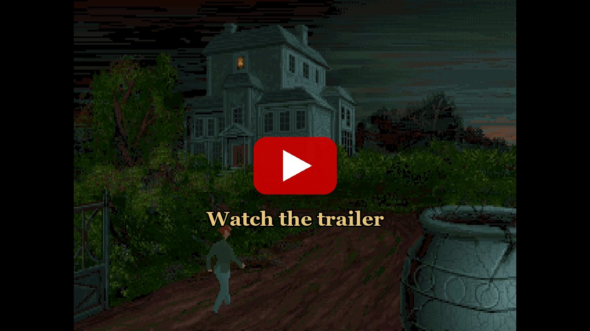</a></p>

## Screenshots

<table>
  <tr>
    <td align="center">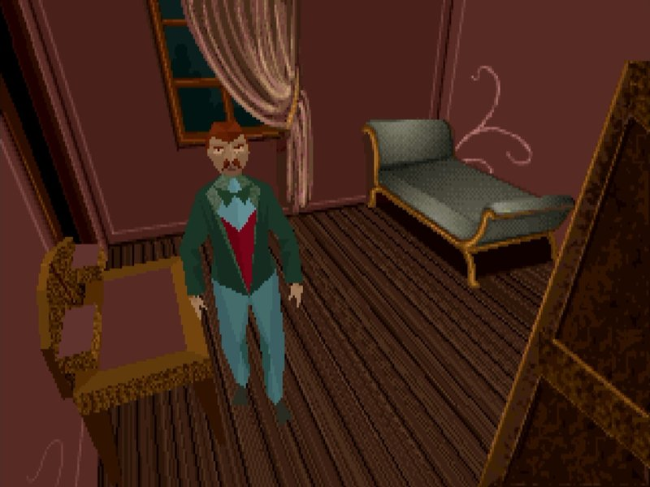<br><sub>The GOG edition</sub></td>
    <td align="center">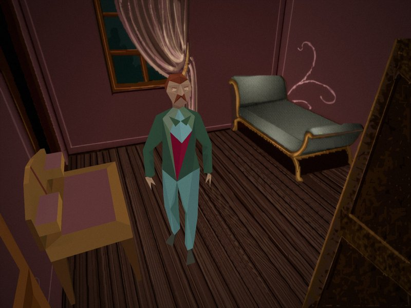<br><sub>Classic Reborn with the HD pack</sub></td>
  </tr>
</table>

<p align="center">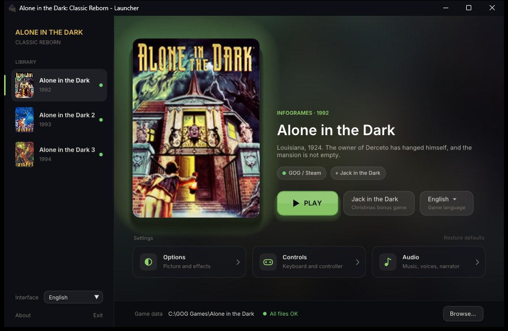<br><sub>The launcher</sub></p>

<details>
<summary><b>More screenshots</b> (Alone in the Dark, Alone in the Dark 2 and 3)</summary>

### Alone in the Dark

<table>
  <tr>
    <td align="center">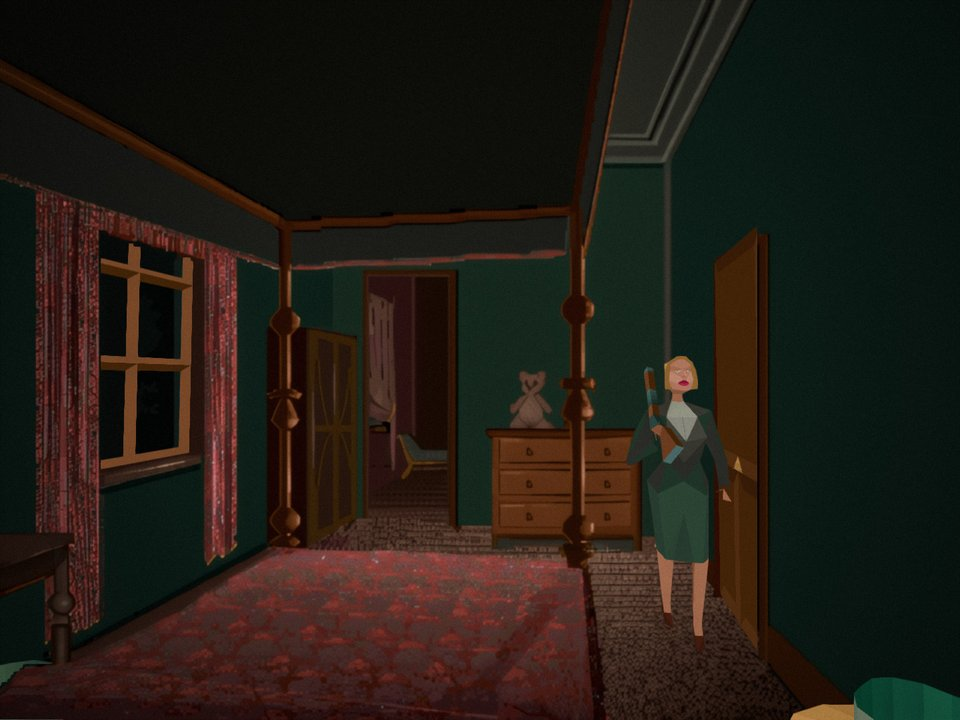</td>
    <td align="center">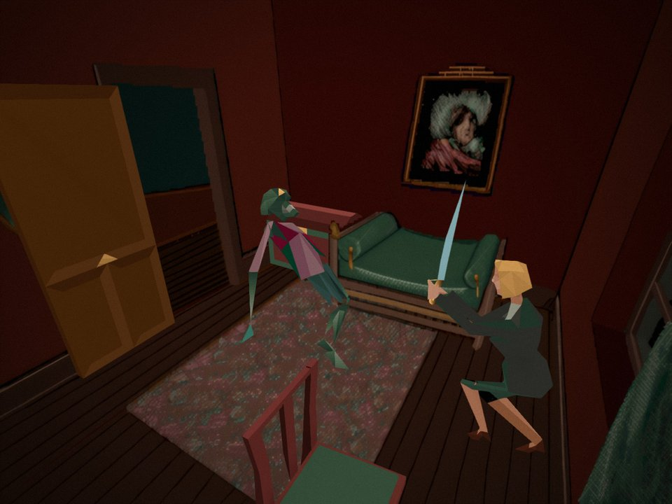</td>
  </tr>
</table>

### Alone in the Dark 2

<table>
  <tr>
    <td align="center">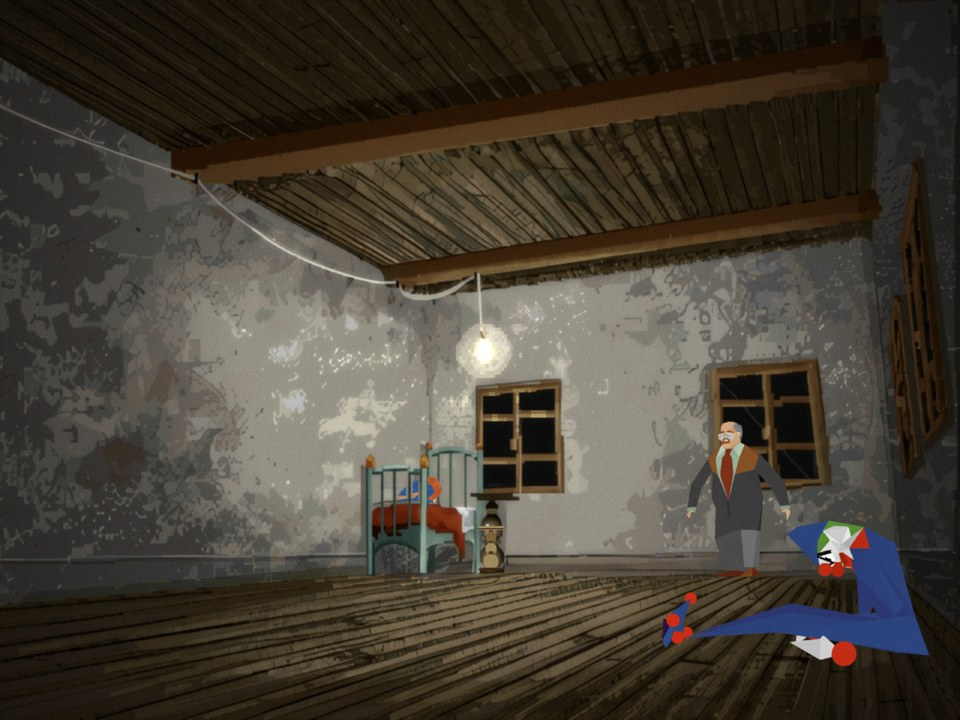<br><sub>The intro, with the HD pack</sub></td>
    <td align="center">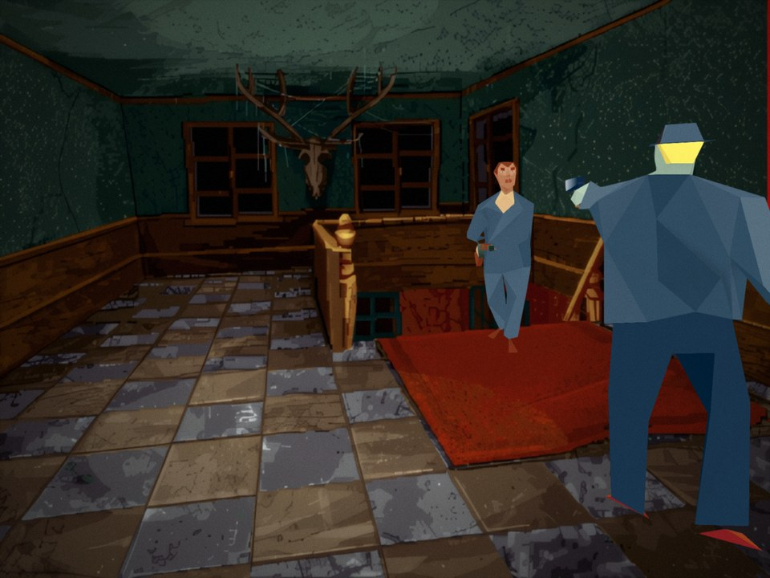<br><sub>Carnby and a gangster, with the HD pack</sub></td>
  </tr>
</table>

### Alone in the Dark 3

<table>
  <tr>
    <td align="center">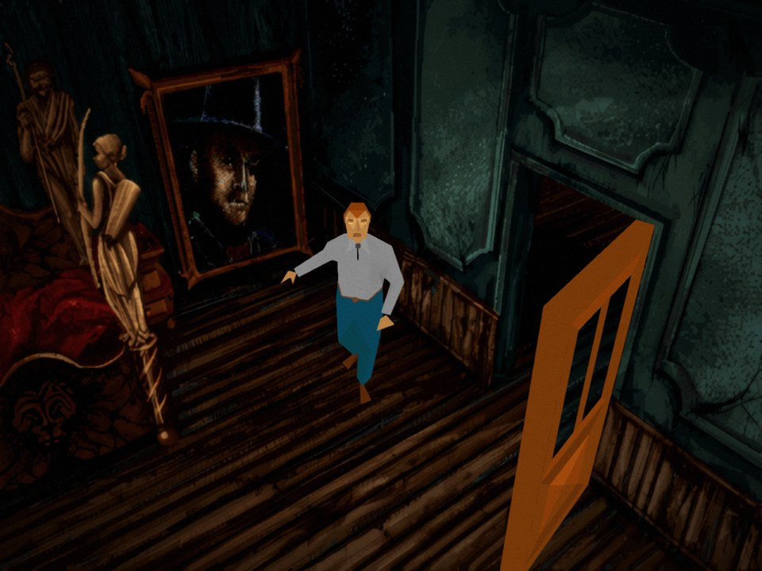<br><sub>Carnby by the portrait, with the HD pack</sub></td>
    <td align="center">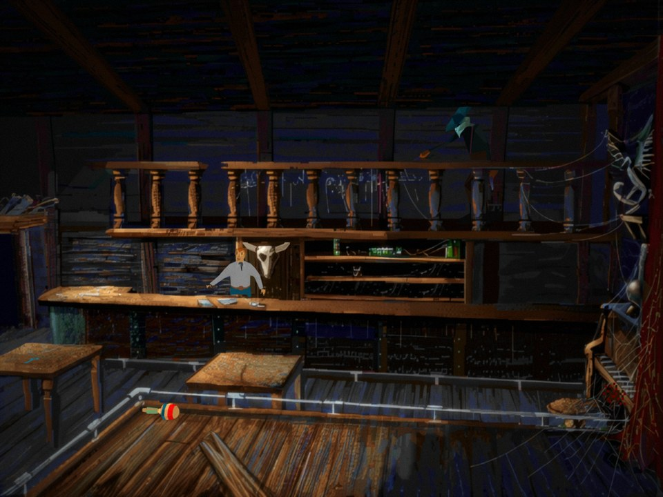<br><sub>The saloon, with the HD pack</sub></td>
  </tr>
</table>

</details>

## How it was made

Classic Reborn started from a **decompilation**: FITD's C++ translation of the original DOS engine. On that base it became a **source port**, the same engine rebuilt for modern systems.

It is not a static recompilation: a static recompilation translates the machine code mechanically into code that runs on another system, without making it readable; here the engine is readable C++ that can be changed and fixed.

- **The engine** comes from FITD, which reverse engineered the DOS executable into readable C++ (renderer, animation, collisions, cameras, inventory, saves...). It is *non-matching*: it behaves like the original, but it does not rebuild the original executable byte for byte. The engine's French function names (`AffObjet`, `LoadEtage`...) come from that work.
- **The game's logic** (doors, monsters, items, events) is not in the executable: it lives in the "Life" scripts of the game's own `LISTLIFE.PAK`, which the engine interprets as the original did. For study, the engine can translate those scripts into readable C++ (`TatouSource/FitdLib/scripts/native/`); the game always runs the original scripts.
- **Everything else** (graphics through bgfx, audio, controls, menus, fixes) is new code. Jack in the Dark's music is written for the AdLib sound chip, which modern PCs no longer have, so it plays through an emulation of that chip.

## Requirements

**To play**

- **Windows** 10 or 11, 64-bit, and a graphics card with DirectX 11.
- Or **Linux**, 64-bit (x86-64): Ubuntu 22.04, Linux Mint 21, Debian 12, Fedora 37 or newer, or any other distribution of the same age, with a graphics card that supports Vulkan or OpenGL.
- Or **macOS** 11 or newer, Apple Silicon or Intel (experimental, see [On macOS](#on-macos-experimental)).
- Or an **Android** phone or tablet with Android 7 or newer, 64-bit (almost every phone since 2017), with Vulkan or OpenGL ES 3.0 (experimental, see [On Android](#on-android-experimental)).
- Your own copy of *Alone in the Dark* (*Jack in the Dark* comes with it), *Alone in the Dark 2* and/or *Alone in the Dark 3*: the GOG or Steam editions, or your original CD as an image (see [Your original CD](#your-original-cd)).
- Nothing else to install: no .NET, no Visual C++ Redistributable, no DirectX setup, no Linux packages. Unpack and run the launcher.

**To build the project**

- On Windows: [Visual Studio 2022](https://visualstudio.microsoft.com/vs/) (the free Community edition works) with the **Desktop development with C++** workload. It includes CMake.
- On Linux: GCC 11 or newer, CMake, Ninja and the development packages of X11, Wayland, OpenGL and the sound systems (the list is in [Building](#building)).
- On macOS: Xcode (or its Command Line Tools), CMake and Ninja; `tools/makeRelease-macos.sh` builds the players' package.
- For Android: JDK 17 and the Android SDK with its NDK (the versions are in `TatouSource/android/app/build.gradle`), on Windows, Linux or macOS.
- [Git](https://git-scm.com/downloads) to download the repository.
- Optional: [Python 3](https://www.python.org/downloads/) for the scripts in `tools/` (dictionary of methods, layer check).
- Every library is included in the repository.

## Supported games

| Game | State |
| --- | --- |
| Alone in the Dark (1992, CD version) | Playable from start to end |
| Jack in the Dark (1993) | Playable from start to end |
| Alone in the Dark 2 (1993, CD version) | Playable from start to end |
| Alone in the Dark 3 (1994, CD version) | Playable from start to end |

## What it adds

- **Fixes** to the original: objects drawn in the wrong order, monsters stuck at windows, gaps in 3D models, lines at the edges of masks, game speed tied to the frame rate, and many more (see `docs/baseline/BUGS.md`).
- **Launcher** to choose the game, its language (the five of the GOG and Steam editions: English, French, German, Italian, Spanish) and the data folder, with the same options as the in-game **F1** window. The menus are translated into the same five languages.
- **Screen options**: resolution, aspect ratio (4:3, 16:10, stretched), integer scaling, fullscreen, frame limit, VSync.
- **Optional effects**: edge smoothing (FXAA) on the 3D models, bloom from the painted backgrounds, film grain, CRT scanlines, ambient occlusion (SSAO), smoother animations, sharper text.
- **Custom backgrounds**: export every background and mask of the game, enlarge or repaint them, and the game uses yours. Ready-made **HD packs** are available for *Alone in the Dark*, *Jack in the Dark*, *Alone in the Dark 2* and *Alone in the Dark 3* (see [Custom backgrounds](#custom-backgrounds)). Backgrounds, masks, animated sequences, music and narrators can all be changed: see the **[modding guide](MODDING.md)**.
- **Controls**: keyboard and game controller (Xbox, PlayStation, Nintendo Switch Pro and most other USB or Bluetooth controllers), every action can be changed, several inputs per action.
- **Modern left stick**: the character walks where you push the stick, seen from the camera, like the Resident Evil HD remasters; the D-pad and the keys stay tank controls (see [Controls](#controls)).
- **Controller vibration**: a little when you are hit or shoot, more when you die; it can be turned off in **Controls**.
- **Cheats** (F1): infinite life (in all four games), behind an "Enable cheats" switch.
- **Your original CD**: play from an image of it (`.cue` and `.bin`, or `.iso`), read as it is (see [Your original CD](#your-original-cd)).
- **Game file check**: the launcher checks the files of your game folder against the editions we know and warns if one is missing or different (see [Checking the game files](#checking-the-game-files)).
- **Separate volumes** for music and for voices and effects.
- **CD or AdLib music** in *Alone in the Dark* and *Alone in the Dark 2*, which come with both.
- **Narrators**: the French CD's narrator (from your own CD) or a fans' dubbing, with any text language; in *Alone in the Dark 2* and *3* the narrator reads the books from the CD, and fans can dub it too (see [Narrators](#narrators)).
- ***Alone in the Dark 3* in any of its languages** over your GOG or Steam installation, with the files of that language (English, French, German, Italian, and Spanish from the original Spanish CD): texts, voices and narrator (see [Other languages in Alone in the Dark 3](#other-languages-in-alone-in-the-dark-3)).
- **Saves** in the format of the GOG edition: saves made in the GOG game load here (the three *Alone in the Dark* games).
- **Menus** that adapt to any window size and work with mouse, keyboard, controller and touch.
- **Android**: the four games on a phone, with on-screen controls as a controller (see [On Android](#on-android-experimental)).

## Getting started

1. Build the project (see [Building](#building)) or get a release.
2. Run **`Launcher.exe`** (next to `Tatou.exe`). On Linux: **`Launcher`** (next to `Tatou`), see [On Linux](#on-linux).
3. Choose the game in the library on the left (**Alone in the Dark**, **Alone in the Dark 2** or **Alone in the Dark 3**), press **Browse** and choose your game folder:
   - a **GOG or Steam installation**: the folder with `GAME.GOG` (or its `INDARK` subfolder; `INDARK2` for *Alone in the Dark 2*, `INDARK3` for *Alone in the Dark 3*). Music and voices are read straight from the CD image (for *Alone in the Dark 3*, from its `MUSIC` folder); nothing is extracted or written there;
   - or a **copy of the game files** (a folder with the `.PAK` files; Jack in the Dark in its `JACK` subfolder);
   - or a folder with **your original CD as an image** (`.cue` and `.bin`, or `.iso`; see [Your original CD](#your-original-cd)).
4. Choose the language of the game and press **Play** (see [Languages](#languages)). *Jack in the Dark* has its own button, next to **Play** on the *Alone in the Dark* page, when its files are found.

**Everything in one folder (portable).** Each game can also live inside `UserData`, in its own **`GAME`** folder (the launcher creates them empty): `UserData\AITD1\GAME` (with *Jack in the Dark*), `UserData\AITD2\GAME` and `UserData\AITD3\GAME`. Copy your GOG or Steam installation there; only these files are needed (the rest, like DOSBox, GOG's saves or the installers, can be left out):

| Game | Files |
|---|---|
| *Alone in the Dark* | `GAME.GOG`, `GAME.INS` (Steam: `GAME.INST`), the `.PAK` and `.ITD` files of `INDARK`, and those of `JACK` for *Jack in the Dark* |
| *Alone in the Dark 2* | `GAME.GOG`, `GAME.INS` (Steam: `GAME.INST`), the `.PAK` and `.ITD` files of `INDARK2` |
| *Alone in the Dark 3* | the `.PAK` and `.ITD` files of `INDARK3` and its `INDARK3.CFG`, and the `MUSIC` folder |

When the launcher opens, a game with no folder chosen takes its `GAME` folder, and so does one whose chosen folder is gone (uninstalled or moved). If neither is there, its folder stays empty for you to choose. With `UserData` and the programs in one folder, everything can be moved or copied to another computer or drive.

**Updates.** When it opens, the launcher asks GitHub for the latest release of this project and, if there is a newer one, offers to install it; the **Update** button next to the version (bottom right) looks again. Installing downloads the package for your system and replaces only the programs and the documents next to them: `UserData` (options, saves, backgrounds) and `launcher.cfg` are never touched. Then close the launcher and open it again. The launcher connects to the internet only for this, and the game never does.

**Starting a game without the launcher** (for example from a frontend that lists your games, each one as its own entry). The simple way is enough for almost everyone: open the launcher once, choose the game folder and the language there, and set the rest with its **Options**, **Controls** and **Audio** cards (or in the game, with F1). From then on, each game only needs its name:

```
Tatou.exe --game aitd1
Tatou.exe --game jack
Tatou.exe --game aitd2
Tatou.exe --game aitd3
```

(`./Tatou --game aitd1` on Linux; in PowerShell, with the full path in quotes, put `&` before it: `& "C:\Games\ClassicReborn\Tatou.exe" --game aitd2`.) The game finds the folder, the language and the options you chose by itself.

Only if you want something else for one entry, add it to the line:

- `--data "<folder>"`: another game folder, the same kind you would choose with **Browse** (for example `--data "C:\GOG Games\Alone in the Dark"` or `--data "C:\GOG Games\Alone in the Dark 2"`);
- `--lang <language>`: another language of the game for that session (`ENGLISH`, `FRANCAIS`, `DEUTSCH`, `ESPAGNOL` or `ITALIANO`).

### Your original CD

If you own the original CD of a game, you can play from an image of it instead of the GOG or Steam edition. Put the image in a folder of its own and choose that folder with **Browse** (or copy it into the game's `GAME` folder of `UserData`):

- a **`.cue` with its `.bin`**: the whole CD, with the music. A `.bin` per track, as many programs make them, works too: keep them all next to the `.cue`;
- or an **`.iso`** (or a `.bin` without `.cue`): the game files only, so the game plays without music.

Everything is read straight from the image: the game files (from its `INDARK`, `INDARK2` or `INDARK3` folder, and *Jack in the Dark* from `JACK`), the voices and the music tracks. Nothing is extracted, and nothing is written next to the image: options, saves and the log go to `UserData`, as with GOG. The languages on the CD are offered in the launcher.

**Editions.** The game knows the files of the GOG and Steam editions, which are the English CDs, and of the Spanish CD of *Alone in the Dark 3*. Other CDs (other countries, other years) should work too, but some may have small differences: the launcher checks the files of your CD as those of any game folder and warns you if one is in no edition we know (see [Checking the game files](#checking-the-game-files)). If something goes wrong, please open an issue saying which edition you have (language, year) and attach `launcher.log` and `tatou.log`: they list the files that differ, which is what we need to make it work. If everything works, please tell us too, so your edition can be added to the known ones.

### Checking the game files

When you choose a game folder (and when the launcher opens), the launcher checks its game files against the editions we know: every `.PAK` and `.ITD` (not the saves) and the game's `.EXE`, by size and checksum. It works the same with a copy, a GOG or Steam installation or your CD image. If it takes more than a moment (a slow drive, a pen drive, a phone), a window shows how far it got. The next time only the files that changed are read again, so it is instant.

- **Files missing**: a file the game needs is not there (a copy that was cut short, for example). The launcher says so in red at the bottom and, before playing, warns that the game will close or freeze when it needs that file, listing the first ones. Copy the game folder again from your installation or your CD.
- **Files in no edition we know**: from another edition, changed or damaged. The launcher says so in red and, before playing, warns that the game may not work well, freeze or close. You can play anyway, and if you changed those files on purpose (a mod), tick **Do not warn again for these files**: the warning comes back only if the files change again.

Both lists, with each file's name, size and checksum, are in `launcher.log` and in `tatou.log` (the game checks too, without waiting, also when it is started without the launcher). Please attach them when you report a problem.

### Languages

GOG and Steam sell the same edition of each game, with the same languages:

| Game | Text | Narrator |
|---|---|---|
| *Alone in the Dark* | English, French, German, Italian, Spanish | English |
| *Jack in the Dark* | English, French, German, Italian, Spanish | none (it never had voices) |
| *Alone in the Dark 2* | English, French, German, Italian, Spanish | English |
| *Alone in the Dark 3* | The one chosen when installing it (English, French, German or Italian); Spanish from the original CD | The one of your installation; Spanish from the original CD |

The narrator reads with any text language. A French narrator only came on the old French CD of *Alone in the Dark* (1993), not in GOG or Steam; if you own it, see [Narrators](#narrators).

**Changing them** takes a click:

- **Game language:** the **Game language** list on each game's page of the launcher. It is kept for next time.
- **Menu language** (launcher and F1): **Interface**, at the top right of the launcher.
- **Narrator**, if you added extra voices: the **Narrator** list of the **Audio** window, in the launcher (its **Audio** card) or in the game with **F1**.

### Other languages in Alone in the Dark 3

GOG and Steam sell *Alone in the Dark 3* one language at a time (English, French, German or Italian), and each language has its own texts, voices, narrator and some data files. Spanish was only on the original Spanish CD. The launcher offers the language of your installation; any other one you own can be added as a folder, and the game reads it over your installation without changing it:

1. Open `UserData\AITD3\Languages` (next to `Launcher.exe`; the launcher creates it the first time it opens) and make a folder in it named `English`, `French`, `German`, `Italian` or `Spanish`.
2. Put that language's files in it, from the `INDARK3` folder of an installation in that language (or the whole folder):

   | Language | Files |
   |---|---|
   | English | `ENGLISH.PAK`, `LISTSAMP.PAK`, `LISTLIFE.PAK`, `ITD_RESS.PAK`, `LISTMAT.PAK`, `LISTTRAK.PAK`, `PRIORITY.ITD` |
   | French | `FRANCAIS.PAK`, `LISTSAMP.PAK`, `LISTLIFE.PAK`, `OBJETS.ITD`, `ITD_RESS.PAK`, `LISTMAT.PAK`, `LISTTRAK.PAK`, `PRIORITY.ITD` |
   | German | `DEUTSCH.PAK`, `LISTSAMP.PAK`, `LISTLIFE.PAK`, `ITD_RESS.PAK`, `LISTMAT.PAK`, `LISTTRAK.PAK`, `PRIORITY.ITD` |
   | Italian | `ITALIANO.PAK`, `LISTSAMP.PAK`, `LISTLIFE.PAK`, `LISTANIM.PAK`, `ITD_RESS.PAK`, `LISTMAT.PAK`, `LISTTRAK.PAK`, `PRIORITY.ITD` |
   | Spanish (CD) | `ESPAGNOL.PAK`, `LISTSAMP.PAK`, `LISTLIFE.PAK`, `PRIORITY.ITD`, `ITD_RESS.PAK` |

   With a French installation, the other languages also need its `OBJETS.ITD`, and French over any other one needs its own: the French version numbers its scripts differently. A folder that lacks a file it needs is not offered (the launcher writes which one in `launcher.log`).
3. For the voiced intro and the narrator, add that language's audio tracks: the files of its `MUSIC` folder (`Track02.ogg`...) as they are, or named after the track minus 1 (`01.ogg`...), as `.ogg`, `.wav` or `.mp3`. Without them, the texts and the voices of the scenes are in that language and the intro and the books are read by the narrator of your installation. The narrator's timing of each language is built into the game.
4. The Spanish CD also works as **an image**: its `.bin` (or `.img`) with its `.cue` of the same name in the `Spanish` folder. Everything is read straight from the image; nothing is extracted.
5. In the launcher, choose the language in the **Game language** list of the *Alone in the Dark 3* page (it appears once the folder is found) and press **Play**.

Your installation is not changed, and choosing its language goes back to it. No game files are included with this project: you need your own copies.

**Saves and French.** A save keeps the number of the script each object is running, and the French version numbers its scripts differently from the others. So a save made in French can only be loaded in French, and one made in English, German, Italian or Spanish only in one of those (as with the original versions). The load screen shows the others as **Other language**. Saves made before this version, and GOG's, carry no language and load as before.

### On Linux

1. Unpack the `.tar.gz` anywhere in your home folder (most file managers open it with a double click, or `tar -xzf ClassicReborn-<version>-linux-x64.tar.gz`).
2. Run `Launcher` from that folder (double click, or `./Launcher` in a terminal).
3. **Browse** to the game installed for Windows (the same for every game):
   - **GOG** with Heroic, Lutris or Wine: the game's folder inside the Wine prefix, the one with `GAME.GOG` (for example `~/Games/Heroic/Alone in the Dark` or `~/Games/Heroic/Alone in the Dark 2`);
   - **Steam** with Proton: `steamapps/common` in your Steam library (by default `~/.steam/steam/steamapps/common`);
   - or a copy of the game files, as on Windows.

   Folders whose name starts with a dot (`.steam`) are hidden: press Ctrl+H in the folder picker to show them, or type the path.

The game runs natively, without Wine or Proton: those are only needed to install the game files. Everything works as on Windows, including music and voices from the CD image and `UserData` next to the programs. Updates from the launcher need `curl` (installed on almost every distribution; otherwise `sudo apt install curl` or your system's equivalent).

**The Linux version is ready to play:** built and tested on Ubuntu, with the GOG installation and a copy of the game files, in *Alone in the Dark* and *Jack in the Dark*. *Alone in the Dark 2* uses the same code and is built for Linux too. Reports from Linux players are very welcome, to keep improving it. Controllers are supported too, with the same code as on Windows (SDL3). If anything does not work on your system (a controller, the sound, the picture...), please open an issue (see [Reporting a problem](#reporting-a-problem)) and we will fix it.

**From Windows (WSL).** The Linux version also runs in WSL2 with Ubuntu. WSL is not a full Linux PC, so for a smooth game it helps to:

- use the graphics card through Mesa's Dozen driver (Vulkan over Direct3D 12): Ubuntu's own Vulkan in WSL draws on the processor;
- send the sound to a PulseAudio server on Windows: WSLg's own sound tends to stop after a while;
- keep the game files inside Linux's disk, not on a Windows drive (`/mnt/c`, `/mnt/d`), so camera changes stay smooth;
- try controllers on a real Linux PC: WSL does not pass them to Linux.

### On macOS (experimental)

**The Mac version is new and experimental.** It is built for every Mac with macOS 11 or newer, Apple Silicon (M1 and later) and Intel, from the same code as Windows and Linux, and it starts and draws with Metal on Apple's system. It is being polished: reports from Mac players are very welcome. Please open an issue with your Mac's model, its macOS version and `tatou.log` (see [Reporting a problem](#reporting-a-problem)).

1. Unpack `ClassicReborn-<version>-macos.tar.gz` (a double click in Finder) into a folder of your own, for example in **Documents** (not in **Downloads**).
2. **The first time**, macOS stops it, because it is not signed with a paid Apple developer account. Open **Terminal**, type `xattr -dr com.apple.quarantine ` (with a space at the end), drag the unpacked folder onto the Terminal window and press Return. This only tells macOS that you trust this folder; it is needed once.
3. Double click **`Launcher`** (it opens with a Terminal window next to it; leave it open while you play).
4. **The game files.** The simplest on a Mac is to copy them into the launcher's own folders: `UserData/AITD1/GAME`, `UserData/AITD2/GAME` or `UserData/AITD3/GAME` (see *Everything in one folder* in [Getting started](#getting-started)). Take them from your GOG or Steam installation on a Windows PC, or from the GOG version for Mac. The launcher finds them by itself. You can also press **Browse** and choose the folder where they are.

Everything else works as on Windows and Linux: the options, the controllers, the saves in `UserData` and the updates from the launcher.

### On Android (experimental)

**The Android version is new and experimental.** It is the same game as on the PC, with the launcher inside the app and on-screen controls. It was played on a Redmi Note 13 (Android 15) with the three games; it is being polished, and reports from Android players are very welcome (see [Reporting a problem](#reporting-a-problem)). It needs Android 7 or newer on a 64-bit phone or tablet. It draws with Vulkan, or with OpenGL ES 3.0 on phones where Vulkan does not start.

1. **Install the app.** On the phone, download `ClassicReborn-<version>-android.apk` from the [latest release](https://github.com/nayo186/AloneInTheDarkClassicReborn/releases/latest) and open it. The first time, Android asks to allow your browser (or file manager) to install apps: allow it. It is not on Google Play, so Play Protect may warn about an unknown app: choose to install anyway. The app is called **Alone in the Dark: Classic Reborn**.
2. **Bring the game to the phone.** Copy a folder with the game to the phone, in any way: with a USB cable to **Download**, on a memory card, from a cloud drive... Any of these:
   - your **GOG or Steam installation** from a PC (the folder with `GAME.GOG`, or with `INDARK3` and `MUSIC` for *Alone in the Dark 3*);
   - a folder with **your original CD as an image** (`.cue` and `.bin`, or `.iso`; see [Your original CD](#your-original-cd)). Import it on the game's page before anything else: once the game is there, a CD image on the *Alone in the Dark* page is taken as a narrator and on the *Alone in the Dark 3* page as a language;
   - a game's folder of **`UserData`** from Classic Reborn on your PC, such as `UserData\AITD3`, with its `GAME` folder and everything you added (`Languages`, `Voices`, `Backgrounds`, `Masks`, `Saves`);
   - the whole **`UserData`** folder, with every game at once.
3. **Import it.** In the launcher, choose the game at the top, press **Import...** and choose that folder ("Use this folder"). The app copies what it recognises, in one go: the game (only the files it uses), and the languages, narrators, custom backgrounds, masks and saves its folder has. A folder named `AITD1`, `AITD2` or `AITD3` goes to that game, whatever the game chosen. You can also import only a language of *Alone in the Dark 3*, a narrator of *Alone in the Dark* or a `Backgrounds` or `Masks` folder later. When the cover turns to colour the game is ready, and the folder you copied can be deleted.
4. Choose the language and press **Play**. The launcher turns with the phone; the game is always on its side.

**Loading the games, step by step** (for example *Alone in the Dark* from GOG, with a USB cable):

1. On the PC, find the game's folder: `C:\GOG Games\Alone in the Dark` for GOG, or `steamapps\common\Alone in the Dark` in your Steam library (the folder with `GAME.GOG` inside). If you already play with Classic Reborn on the PC, you can take `UserData\AITD1` from its folder instead: it brings your saves, narrators and backgrounds too.
2. Connect the phone to the PC with a USB cable and, on the phone, choose **File transfer** in the USB notification.
3. On the PC, the phone shows up as a drive: copy the whole folder into its **Download** folder.
4. On the phone, open **Alone in the Dark: Classic Reborn**, choose **AITD** at the top and press **Import...** at the bottom.
5. Android's folder picker opens: go to **Download**, tap the game's folder (go *into* it) and press **Use this folder**, then **Allow**.
6. Wait for "Copying the game... 100%" and "Game imported.": the cover turns to colour and the game is ready. The copy in **Download** can now be deleted.

The same for *Alone in the Dark 2* and *3*, each chosen at the top, or all at once by importing the whole `UserData` folder from the PC. Instead of a cable, the folder can come on a memory card, a USB stick or from a cloud drive: whatever lets you put it on the phone.

**Why import?** Android keeps each app's files to itself: the game lives in the app's own folder (`Android/data/com.classicreborn.game/files`, with `UserData` inside, as on the PC), and since Android 11 other apps and the phone's file manager cannot copy into it. Import is the way in. Uninstalling the app deletes that folder, games and saves included.

**On-screen controls.** A semi-transparent controller over the game, sized the same on every phone: in the black bars at the sides of the picture when they are wide enough, otherwise over its edges. It is a virtual controller with the same buttons as the [Controls](#controls) table: the **D-pad** (bottom left) is the tank control and the **stick** (it appears where you put your thumb on the left half) walks where you push it, as the modern left stick; **A**, **B**, **Y**, **Start**, **Back** and **RT** do what they do on a controller. Only the buttons that have an action show (Y only in *Alone in the Dark 3*), and a change in **Controls** changes them too. Several fingers work at once. They hide when a controller (Bluetooth or USB) or a keyboard is used, and come back with a touch. Android's **Back** key is **B** (pause). The menus (launcher and F1) work with the finger: tap to choose, drag to scroll.

**Updates.** As on the PC, the launcher looks for a newer version when it opens (and with **Update**). Installing downloads the new app and Android asks you to update it: accept. Your games, saves and options are kept. The first time, Android asks to allow the app to install apps: allow it.

## Controls

Every action can be changed in **Controls** (the launcher's **Controls** card, or F1 in the game). It has two tabs, **Keyboard** and **Controller** (LB and RB switch them): the controller tab is a picture of the controller where each button says what it does, and a click on it (or A) changes that. With a PlayStation or Switch controller connected, the buttons get their own names. Defaults:

| Action | Keyboard | Controller |
| --- | --- | --- |
| Move | Arrows or W A S D | D-pad (tank) or left stick (modern) |
| Run | Left Shift | L3 or right trigger |
| Quick turn (half round) | Back + Run | Back + Run |
| Action (use, fight, take) | Space | A |
| Confirm / inventory | Enter | Start |
| Cancel / pause menu | Esc | B |
| Map (Alone in the Dark 3) | Tab | Y |
| Options window (F1) | F1 or Home | Back |
| Fullscreen | F11 or Alt+Enter | — |

**Running and turning.** Hold **Run** while moving forward to run (double-tapping forward also works, as in the original game). Press **back and Run** together for a quick turn: the character turns half round, as in the Resident Evil HD remaster.

**Controllers.** Controllers are supported on Windows and Linux: any controller SDL3 recognises, connected by USB or Bluetooth (also while playing), such as Xbox (One, Series, 360), PlayStation (DualShock 4, DualSense), Nintendo Switch Pro and most generic controllers. If yours does not work as expected, please open an issue (see [Reporting a problem](#reporting-a-problem)) with its name. The table uses the Xbox names; on other controllers the buttons are in the same place:

| Xbox | PlayStation | Switch Pro |
| --- | --- | --- |
| A | Cross (✕) | B |
| B | Circle (○) | A |
| Start | Options | + |
| Back | Share / Create | − |
| L3 (press the left stick) | L3 | Left stick press |
| Right trigger | R2 | ZR |

**Modern left stick.** With the left stick the character walks where you push it, seen from the camera: up walks away from the camera, down towards it. When the camera changes, the direction is kept until you release the stick or push it elsewhere, so you never walk back into the room you left. While **Action** is held (to fight), the stick gives the tank directions, as the attacks need them. The D-pad and the keys are always tank controls: up walks forward, left and right turn. To use the left stick as tank controls too, untick **Modern left stick** in **Controls**.

**Vibration.** The controller vibrates a little when you are hit and at each of your shots (a weapon that fires several times in a row vibrates at each shot), and more when you die. To turn it off, untick **Controller vibration** in **Controls** (in the game with F1, or in the launcher).

The menus (launcher and F1) also work with the controller: left stick or D-pad to move, right stick to scroll, A to choose, B to go back. The mouse cursor hides while the controller is in use and comes back when the mouse moves.

**On Android**, the same controls are on the screen as a controller (see [On Android](#on-android-experimental)); a Bluetooth or USB controller works too.

## Options

The launcher (its **Options**, **Controls** and **Audio** cards) and the in-game **F1** window share the same settings, saved in `aitd_remaster.cfg`:

| Option | What it does |
| --- | --- |
| Frames per second, VSync | Smoothness; the game speed never depends on them |
| Aspect ratio, resolution, fullscreen | How the 4:3 scene is shown |
| Integer scaling | Every pixel of the game the same size, with black borders around (like pixel-perfect scaling in DOSBox): **Size**: Automatic, the largest that fits, or a size of your choice; **3D resolution**: how sharp the 3D models are, down to the original 320 × 200. Off by default; while it is on, Resolution is not used |
| Edge smoothing | FXAA on the 3D models |
| Bloom | A soft glow from the bright parts of the painted backgrounds |
| Film grain | A light grain over the picture |
| Scanlines | Thin dark lines over the picture, like an old CRT screen; under it, their intensity from 1 (soft) to 4 (strong) |
| SSAO | Soft shadows where surfaces meet |
| Smooth animations | Poses blended between the original key frames |
| Enhanced text | The game's letters redrawn sharp at screen resolution |
| Custom backgrounds | Uses your pictures instead of the originals |
| Audio | Music volume, voices and effects volume, music type (CD or AdLib, in *Alone in the Dark* 1 and 2), narrator |
| Controls | The inputs of every action, modern left stick, controller vibration |
| Cheats (F1 only) | **Enable cheats** turns them on or off; **Infinite life**: damage never kills you, the game's traps (deadly falls, scripted deaths) still do |

## Folders

Nothing is ever written to the game folder (not even to a `GAME` folder inside `UserData`). Everything the game writes goes to **`UserData`**, next to the executables:

```
UserData/
├── aitd_remaster.cfg      options (shared by all the games)
├── AITD1/                 Alone in the Dark
│   ├── Saves/             saves (SAVE0.ITD ... and their pictures SAVE0.png ...)
│   ├── tatou.log          log of the last session (tatou.prev.log: the one before)
│   ├── crash_log.txt      written if the game closes by itself
│   ├── Backgrounds/       your backgrounds and full-screen pictures
│   ├── Masks/             your masks
│   ├── Exports/           what F1 exports (masks in masks/, with guides in masks_guides/)
│   ├── Voices/            other narrators, one folder each (see Narrators)
│   └── GAME/              the game itself, if you keep it here (see Getting started)
├── JACK/                  Jack in the Dark (same layout, without GAME: it is in AITD1's)
├── AITD2/                 Alone in the Dark 2 (same layout, without Voices: its
│                          narrator's recordings go in the folder itself, see Narrators;
│                          with its own GAME)
└── AITD3/                 Alone in the Dark 3 (as AITD2, with its own GAME), and
    └── Languages/         other languages, one folder each (see
                           Other languages in Alone in the Dark 3)
```

`launcher.cfg` and `launcher.log`, next to `Launcher.exe`, keep the launcher's own settings.

What you can put in these folders to change the games (backgrounds, masks, sequences, music, narrators) is explained in the **[modding guide](MODDING.md)**.

## Custom backgrounds

**HD packs.** HD backgrounds ready to use, for each game:

- *Alone in the Dark* and *Jack in the Dark*: **[download from Google Drive](https://drive.google.com/file/d/1ps4ZVv-tBio4YYLrr8lVeiR8kiYFy5Z1/view?usp=sharing)** (a `.rar` file: Windows 11 opens it, or use [7-Zip](https://www.7-zip.org/)). Copy each game's pictures into `UserData\AITD1\Backgrounds` and `UserData\JACK\Backgrounds`.
- *Alone in the Dark 2*: **[download from Google Drive](https://drive.google.com/file/d/1TJAbAFtaVNr7sVnREjCp1ATIuWSu6tuw/view?usp=sharing)**. Copy its pictures into `UserData\AITD2\Backgrounds`.
- *Alone in the Dark 3*: **[download from Google Drive](https://drive.google.com/file/d/1S0qRXvsVeq4HfAyVkofXynHUf97LQh-2/view?usp=sharing)**. Copy its pictures into `UserData\AITD3\Backgrounds`.

Then switch on **Custom backgrounds** in F1 or in the launcher. The packs have backgrounds only: the game's own masks keep working with them. You can also make your own, or mix both.

To make your own:

1. In F1, **export** the backgrounds and the masks. They go to `Exports/` as PNG files at the original 320×200, named after their place in the game files (`CAMERA00_000.png`, `CAMERA00_000_mask_1_0.png`...).
2. Enlarge or repaint them with any tool. Any size works:
   - **16:10** like the original (320×200, 1280×800...) or **4:3**: the whole picture is the play area;
   - **wider than 4:3** (16:9...): its 4:3 centre is the play area and the sides fill the black bars in fullscreen.
3. Save them with the same name in `Backgrounds/` (masks in `Masks/`; white covers the characters). Switch on **Custom backgrounds**: pictures saved while playing appear at once.

Masks matter when your picture moves or redraws an object that stands in front of the characters.

**All the details** (names, sizes, masks, sequences, music, narrators, and how to share a mod) are in the **[modding guide](MODDING.md)**.

**Animated sequences** (*Jack in the Dark*, *Alone in the Dark 2* and *Alone in the Dark 3*: the intro, the cut scenes...) can be redrawn picture by picture too: **Export sequences** in F1 writes each one to `Exports/sequences/<NAME>/` (`000.png`, `001.png`...); a picture saved with the same name in `Backgrounds/sequences/<NAME>/` replaces it.

## Narrators

In *Alone in the Dark* the narrator reads the books, letters and notes aloud, page by page (for *Alone in the Dark 2*, see [below](#alone-in-the-dark-2-1)). The GOG and Steam editions have one narrator, in English, and it reads with any text language. Other narrators can be added, each one in its own folder of **`UserData\AITD1\Voices`**; they appear in the **Narrator** list of the **Audio** window (launcher and F1), which stays on **English** until a folder with voices is found. Any narrator works with any text language: every language has the same pages.

**The French CD.** The French CD-ROM edition (1993) has its own narrator. If you own it, put its voices in `UserData\AITD1\Voices\French`, in one of these forms:

- the `.VOC` files of its `INDARK` folder, copied from the CD;
- an image of the CD: an `.iso`, or a `.bin` (with or without its `.cue`). The voices are read straight from the image; nothing is extracted.

The voices are not included with this project: you need your own CD.

**Changing the narrator**, step by step:

1. Open `UserData\AITD1\Voices` (next to `Launcher.exe`; the launcher creates it the first time it opens).
2. Put the narrator's folder there: `French` with the French CD's voices (above), or the folder of a dubbing (below), e.g. `UserData\AITD1\Voices\Spanish (fan dub)\000000.wav`...
3. In the launcher: **Audio** → **Narrator**, and choose it. In the game it is the same: **F1** → **Audio** → **Narrator**; the next page you read uses it.
4. To go back to the original narrator, choose **English** in the same list.

The list only shows the folders where voices were found: if yours is missing, check that it has the file `000000` (see below) or a CD image with an `INDARK` folder.

**Your own dubbing.** Anyone can record a narrator in another language (or a new English one), use it in the game as explained above and share it as a folder. The folder's name is the narrator's name in the list (`Spanish`, `German`, `Italian`, `French` and `English` are shown translated; any other name as it is, e.g. `Spanish (fan dub)`). Inside, the voice files follow the game's numbering:

| | |
| --- | --- |
| **Name** | `BBSSNN` + extension: `BB` the book (`00`-`19`), `SS` its page (`00` = the first), `NN` a piece of that page (`00`, `01`...) |
| **Formats** | `.wav`, `.ogg` or `.voc`; mono or stereo, any sample rate (they are joined and converted when played) |
| **A page** | its pieces play in order until the first missing one, so **one file per page is enough**: `BBSS00` |
| **Required** | `000000` (book 0, page 0): without it the folder is not listed |
| **Missing pages** | a page without a file is read by the English narrator; a page never mixes narrators |

To know which text a page is, read the books in the game with the English narrator: each page you see is one file (`tatou.log` names each one, e.g. `Voice of book 1 page 2`). The pages of a book are the same in every text language. **The empty page.** The 5th page of *Story of a Louisiana Plantation* (book `10`, page `04`) has no text in any language: nothing is read there. In a dubbing, simply leave out `100400` and number the other pages as the English narrator does (`100500` is the 6th page). The French CD numbers them differently (it has no number for the empty page, so its `100400` is the 6th page); the game recognises that numbering too, so a dubbing made that way also works.

Please share only recordings you made yourself, never the voices of the game or of its CDs.

### Alone in the Dark 2

In *Alone in the Dark 2* the narrator (in English, with any text language) reads the books and letters from the CD's audio tracks, as the CD version did: each page plays one track for a set number of seconds, and the music stops while the narrator reads. With the GOG or Steam edition this works by itself: the tracks are read from `GAME.GOG`. The **Narrator** list of the Audio window is for *Alone in the Dark* only.

**Your own dubbing.** Put your recordings in **`UserData\AITD2`** (next to `Launcher.exe`), one file per page, named after the CD track they replace: `22.ogg`, `43.wav`... (`.ogg`, `.wav` or `.mp3`). A file there is played instead of the CD's track; a page without a file keeps the original voice. Nothing in the game folder is changed.

| Text | Its pages, in order: file (seconds) |
| --- | --- |
| Crew muster, the whole crew (9 pages) | `43` (12), `46` (39), `47` (27), `48` (41), `49` (28), `54` (31), `55` (19), `56` (40), `57` (10) |
| Crew muster, Tom Flaherty | `43` (12), `50` (41), `51` (11) |
| Crew muster, Shorty Leg | `43` (12), `44` (37), `45` (22) |
| Crew muster, the Music Man | `43` (12), `52` (39), `53` (15) |
| Chess and Magik | `28` (29) |
| With Cue in Hand | `22` (5), `23` (44), `24` (45), `25` (28) |
| "I was caught out. The witch twisted a puppet..." | `38` (27) |
| A Powder Plot | `39` (11), `40` (35), `41` (38), `42` (38) |
| Immortality | `32` (11), `33` (27), `34` (28), `35` (28) |
| The telegram, "Dear Mr Jack!" | `62` (19) |
| The letter to Carnby, "Carnby, if you read this..." | `26` (53), `27` (13) |
| The pact of Sean O'Leary, the Music Man | `36` (35), `37` (8) |
| I Overcame Voodoo | `58` (9), `59` (43), `60` (42), `61` (26) |
| Life and Times of the Freebooters | `29` (4), `30` (45), `31` (38) |

- **The seconds:** each page stops after the time of the original recording, so keep yours that long or shorter.
- **The first page of every crew muster** is the same heading (`43`): one recording serves all four.
- **`27`**, the second page of the letter to Carnby, has no voice in the original (that track of the CD is data, not sound): a recording there adds one.
- To check which file a page uses, read it in the game: `tatou.log` notes each one (`Playing VO: CD track 44`: the file is the track number minus 1, `43`).
- The files of the music tracks (`01` to `21`) can be replaced the same way.

Please share only recordings you made yourself, never the voices of the game or of its CD.

### Alone in the Dark 3

*Alone in the Dark 3* reads its books and letters the same way, from the CD's audio tracks 24 to 61 (with the GOG edition, from its `MUSIC` folder), and the story pictures, such as the piano's, with the voices of the game. A dubbing works as in *Alone in the Dark 2*: put the recordings in **`UserData\AITD3`**, named after the track they replace minus 1 (`23.ogg` ... `60.ogg`); `tatou.log` names the track of each page (`Playing VO: CD track 45`: the file is `44`).

## Saves

Saves of *Alone in the Dark* use the layout of the GOG edition: saves made in the GOG game (`cloud_saves\INDARK` in its folder) can be copied to `UserData\AITD1\Saves` and loaded. The other way round works too, except that the lamp's oil does not run out in the GOG game with a save made here (known issue). The save list shows the date and time of each save.

Saves of *Alone in the Dark 2* use the layout of the GOG edition too: the GOG game's saves (`cloud_saves\INDARK2`) can be copied to `UserData\AITD2\Saves` and loaded, and the other way round.

Saves of *Alone in the Dark 3* use the layout of the GOG edition too. The GOG game keeps them in `cloud_saves\INDARK3`, in a folder per state (`SAVE00` California, `SAVE01` Montana, `SAVE02` Nevada, `SAVE03` Oklahoma) with up to six slots each (`SAVE0.ITD` ... `SAVE5.ITD`, the slots A to F). Copy one to `UserData\AITD3\Saves` as `SAVEn.ITD` and it loads here; a save made here can be copied the other way and loads in the GOG game. Here the list is the same as in the other games: eight slots with the date and time, without states or names.

## Reporting a problem

Found a bug? Please open an [issue](https://github.com/nayo186/AloneInTheDarkClassicReborn/issues) and tell us:

- what happened and what you were doing (where in the game, if you can);
- in which game: *Alone in the Dark*, *Jack in the Dark*, *Alone in the Dark 2* or *Alone in the Dark 3*;
- on which system: **Windows**, **Linux** (and which distribution), **macOS** (and your Mac's model) or **Android** (your phone's model and Android version);
- where you bought the game (GOG or Steam) and the language you play in. Just tell us which: there is no need to send the installed game.

It helps a lot to attach these files: drag them into the issue's text box. Close the game first, so the logs are complete:

- **The logs**, in `UserData\AITD1` (or `UserData\JACK`, `UserData\AITD2`, `UserData\AITD3`), next to `Launcher.exe`:
  - `tatou.log`: the last session;
  - `tatou.prev.log`: the session before it (if you opened the game again after the problem, the problem is in this one);
  - `crash_log.txt`, if the game closed by itself;
  - `launcher.log`, next to `Launcher.exe`, if the problem is in the launcher.
- **A save** made just before the problem, if you can: `UserData\AITD1\Saves\SAVEn.ITD` (or `UserData\AITD2\Saves\...`, `UserData\AITD3\Saves\...`; n is the slot). GitHub does not accept `.ITD` files, so put the save in a `.zip` first. With it we can go straight to that spot.

**On Android** the same files are in the app's folder, `Android/data/com.classicreborn.game/files` (with `UserData` inside, and `launcher.log`). The phone's file manager may not open it: connect the phone to a PC with a USB cable (choose *File transfer* on the phone) and copy them from there.

The logs only name the game's folders and what the game did; they may show your user name inside a folder path (`C:\Users\<name>\...`). Nothing else from your PC is in them.

## Building

See [Requirements](#requirements). From the folder of the repository:

```
cmake -G "Visual Studio 17 2022" -A x64 -S TatouSource -B TatouSource\build\vs2022
```

Open `TatouSource\build\vs2022\FITD.sln`, choose **RelWithDebInfo x64** and build. `Launcher.exe` and `Tatou.exe` end up together in `TatouSource\build\vs2022\Fitd\RelWithDebInfo`; `Launcher` is the start project.

**On Linux** (Ubuntu or Debian; other distributions have the same packages under similar names):

```
sudo apt install build-essential cmake ninja-build pkg-config \
  libx11-dev libxext-dev libxrandr-dev libxcursor-dev libxi-dev libxss-dev \
  libxfixes-dev libxinerama-dev libxtst-dev libwayland-dev libxkbcommon-dev \
  wayland-protocols libdecor-0-dev libgl1-mesa-dev libegl1-mesa-dev \
  libgles2-mesa-dev libdrm-dev libgbm-dev libasound2-dev libpulse-dev \
  libpipewire-0.3-dev libudev-dev libdbus-1-dev libibus-1.0-dev
cmake -G Ninja -S TatouSource -B TatouSource/build/linux -DCMAKE_BUILD_TYPE=RelWithDebInfo
cmake --build TatouSource/build/linux
```

`Launcher` and `Tatou` end up together in `TatouSource/build/linux/Fitd/RelWithDebInfo`. A crash is written, with the functions that led to it, to `crash_log.txt` and `tatou.log`, as on Windows.

**Development tools.** The CMake option `CLASSIC_REBORN_DEV_TOOLS` (on by default) builds two tools that only work in debug mode: **F9** gives any item, **F10** is the object editor used to make the visual fixes of 3D objects. For a build to share with players, turn it off:

```
cmake -S TatouSource -B TatouSource\build\vs2022 -DCLASSIC_REBORN_DEV_TOOLS=OFF
```

**Debug mode** is switched on by hand: `debugMode = 1` in `launcher.cfg`. With a copy of the game files it also keeps every file the game writes inside that copy.

**For Android** the project is `TatouSource/android` (Gradle; the engine and the launcher are built into the app as `libmain.so`, from the same CMake project). With JDK 17 and the Android SDK, from that folder:

```
gradlew assembleDebug
```

The app ends up in `app/build/outputs/apk/debug`. It is signed with Android's debug key unless the project's key is given (`CLASSIC_REBORN_KEYSTORE` and its passwords, see `tools/makeRelease-android.sh`); an app signed with another key cannot update the published one, so uninstall that first (which deletes its games and saves).

**Releases.** The packages of each release are built by GitHub Actions (`.github/workflows/release.yml`) with the same scripts: publishing a release with a tag like `v1.0.0` attaches `ClassicReborn-1.0.0-windows-x64.zip` (64-bit Windows), `ClassicReborn-1.0.0-linux-x64.tar.gz` (64-bit Linux, built on Ubuntu 22.04 so that it runs on that and every newer system), `ClassicReborn-1.0.0-macos.tar.gz` and `ClassicReborn-1.0.0-android.apk` (signed with the project's key, kept as a secret of the repository) to it. Locally: `powershell -ExecutionPolicy Bypass -File tools\makeRelease.ps1 -Version 1.0.0` on Windows, `tools/makeRelease.sh 1.0.0` on Linux, `tools/makeRelease-macos.sh 1.0.0` on macOS and `tools/makeRelease-android.sh 1.0.0` for Android.

## Architecture

```
┌──────────────────────────────────────────────────────────────────────────┐
│  Tatou.exe  (Fitd/fitd.cpp)        starts the engine, connects remaster  │
└────────────────────────────────────┬─────────────────────────────────────┘
                                     │
┌────────────────────────────────────▼─────────────────────────────────────┐
│  remaster/                   optional additions                          │
│  ┌──────────────┐ ┌────────────────────┐ ┌────────────┐ ┌──────────────┐ │
│  │  F1 window   │ │ custom backgrounds │ │ 3D object  │ │ F9 / F10     │ │
│  │ menu fonts   │ │ export / import    │ │ fixes      │ │ dev tools    │ │
│  └──────────────┘ └────────────────────┘ └────────────┘ └──────────────┘ │
└────────────────────────────────────┬─────────────────────────────────────┘
                     ▲ hooks         │ uses
┌────────────────────┴───────────────▼─────────────────────────────────────┐
│  core/ + scripts/            the 1992 game                               │
│  ┌──────────────┐ ┌──────────────┐ ┌──────────────┐ ┌──────────────────┐ │
│  │ rooms        │ │ objects      │ │ inventory    │ │ Life scripts     │ │
│  │ cameras      │ │ animation    │ │ books        │ │ (interpreter)    │ │
│  │ masks        │ │ collisions   │ │ saves        │ │ native C++ copy  │ │
│  └──────────────┘ └──────────────┘ └──────────────┘ └──────────────────┘ │
└────────────────────────────────────┬─────────────────────────────────────┘
                     ▲ hooks         │ uses
┌────────────────────┴───────────────▼─────────────────────────────────────┐
│  platform/                   the system                                  │
│  ┌──────────────┐ ┌──────────────┐ ┌──────────────┐ ┌──────────────────┐ │
│  │ window       │ │ renderer     │ │ audio        │ │ input, controls  │ │
│  │ ImGui        │ │ screen       │ │ CD tracks    │ │ settings         │ │
│  │              │ │ effects      │ │ AdLib, VOC   │ │ game folders     │ │
│  └──────────────┘ └──────────────┘ └──────────────┘ └──────────────────┘ │
└────────────────────────────────────┬─────────────────────────────────────┘
                                     │
┌────────────────────────────────────▼─────────────────────────────────────┐
│  util/        types · log file · PAK decompression · threads             │
└──────────────────────────────────────────────────────────────────────────┘

┌───────────────┐    ┌──────────────────────────────────┐
│ Launcher.exe  ├───►│ Shared/  menus, texts, controls  │◄── also used by the game
└───────────────┘    └──────────────────────────────────┘

Libraries: bgfx (graphics) · SDL3 (window, input) · SoLoud (audio) · Dear ImGui (menus) · zlib
```

The same structure as a graph: who uses whom (solid arrows) and where the hooks go up (dotted arrows).

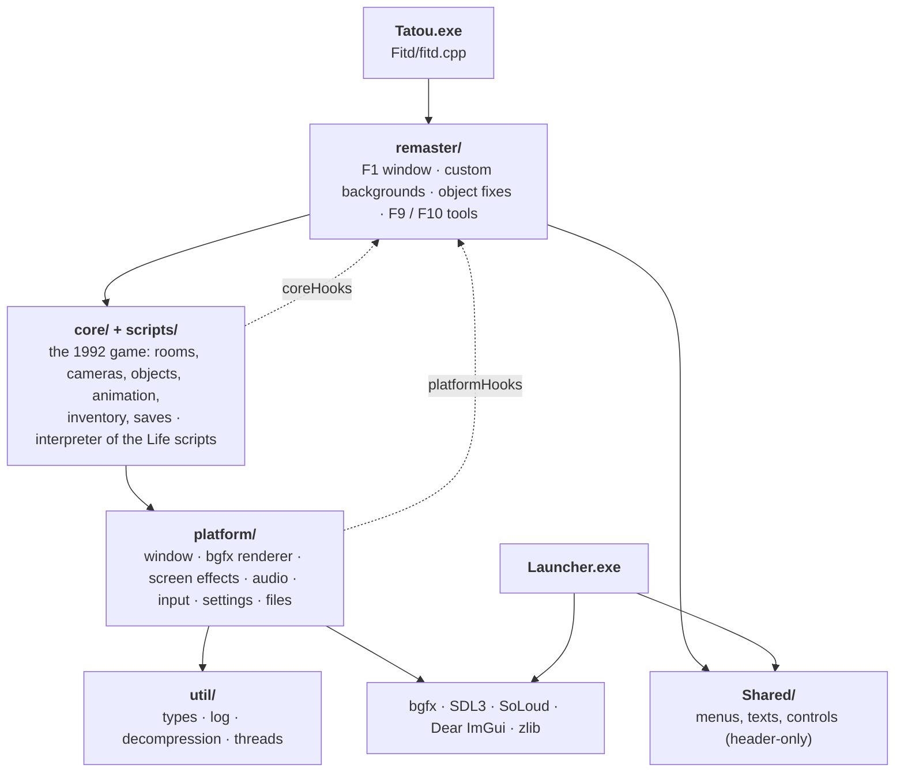

Each layer only uses the layers below it. When a lower layer has something to announce (a camera background is ready, the menus can be drawn, a key was pressed...), it calls a **hook**: an empty function pointer that the remaster fills in when it starts. With no remaster connected, the engine behaves as the original game.

More detail:

- `docs/MAPA_CODIGO.md`: every folder and file, the shaders and a glossary of the engine's French names.
- `docs/DICCIONARIO.md`: every public function and what it does, generated from the headers by `tools/makeDictionary.py`.
- `docs/baseline/BUGS.md`: the defects found and how each one was fixed.
- `docs/DESCARTADO.md`: what was removed from the remaster and why.
- `CHANGELOG.md`: the changes of this fork before it was published.
- `tools/checkLayers.py`: lists any `#include` that goes against the layer order.

These documents are in Spanish for now.

## Credits

This project exists thanks to the people who came before it. Re-Haunted brought the engine to modern systems and added many of the ideas this fork builds on; FITD made the engine readable in the first place. Some of their features were removed here only because this fork has a narrower goal (the 1992 game with its original graphics), not because of their quality; `docs/DESCARTADO.md` explains each removal.


- **FITD (Free in the Dark)**: the reverse-engineered engine, by yaz0r and contributors: <https://github.com/yaz0r/FITD>
- **Alone in the Dark: Re-Haunted**: the remaster this fork comes from, by Spacefarer Retro Remasters (Jake Jackson): <https://github.com/spacefarergames/AloneInTheDarkReHaunted>
- **Alone in the Dark** and **Jack in the Dark** were created by Infogrames. This project contains none of their data and is not affiliated with their rights holders.
- Libraries: [bgfx](https://github.com/bkaradzic/bgfx), [SDL3](https://github.com/libsdl-org/SDL), [SoLoud](https://github.com/jarikomppa/soloud), [Dear ImGui](https://github.com/ocornut/imgui), [zlib](https://zlib.net), and the OPL2 (AdLib sound chip) emulator from MAME, which plays Jack in the Dark's music: it was written for that chip, which modern PCs no longer have.
- **Inter**, the menus' font (launcher and F1), by Rasmus Andersson and the Inter Project Authors, under the SIL Open Font License 1.1 (`Inter-OFL.txt` next to the programs): <https://github.com/rsms/inter>
- **Gelasio**, also compiled into the programs, by Eben Sorkin and the Gelasio Project Authors, under the SIL Open Font License 1.1 (`Gelasio-OFL.txt` next to the programs): <https://github.com/SorkinType/Gelasio>

## License

GNU General Public License v2: see [LICENSE](LICENSE). The libraries in `TatouSource/ThirdParty` keep their own licenses.
