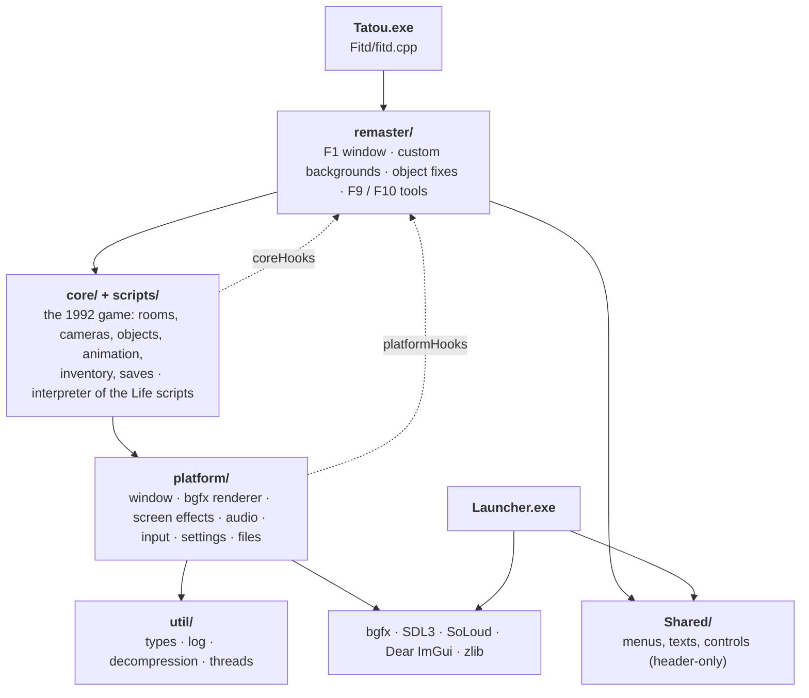

# Alone in the Dark: Classic Reborn

Play the original **Alone in the Dark** (1992) and **Jack in the Dark** on modern PCs, with their original graphics and a set of careful fixes and options.

**[⬇ Download the latest version](https://github.com/nayo186/AloneInTheDarkClassicReborn/releases/latest)** for Windows or Linux: unpack it, run `Launcher.exe` (`Launcher` on Linux) and choose your GOG or Steam copy of the game. Nothing else to install.

Classic Reborn is a C++17 reimplementation of the Infogrames engine. It is a fork of [Alone in the Dark: Re-Haunted](https://github.com/spacefarergames/AloneInTheDarkReHaunted), itself based on [FITD (Free in the Dark)](https://github.com/yaz0r/FITD) by yaz0r. Its goal is the 1992 game as it was meant to be seen, without its defects: the remaster's HD mode was removed and every addition is optional.

> **The game data is not included.** You need your own copy of *Alone in the Dark* (the GOG or Steam edition). Nothing of the original game is in this repository.

## Screenshots

<table>
  <tr>
    <td align="center"><br><sub>The GOG edition</sub></td>
    <td align="center"><br><sub>Classic Reborn with the HD pack</sub></td>
  </tr>
  <tr>
    <td align="center"></td>
    <td align="center"></td>
  </tr>
</table>

<p align="center"><br><sub>The launcher</sub></p>

## How it was made

Classic Reborn is a **source port**: a hand-written reimplementation of the original engine in C++, not an automatic decompilation and not a static recompilation.

- **The engine** comes from FITD, which reverse engineered the DOS executable by hand into readable C++ (renderer, animation, collisions, cameras, inventory, saves...). It is *non-matching*: it behaves like the original, but it does not rebuild the original executable byte for byte. The engine's French function names (`AffObjet`, `LoadEtage`...) come from that work.
- **The game's logic** (doors, monsters, items, events) is not in the executable: it lives in the "Life" scripts of the game's own `LISTLIFE.PAK`, which the engine interprets as the original did. For study, the engine can translate those scripts into readable C++ (`TatouSource/FitdLib/scripts/native/`); the game always runs the original scripts.
- **Everything else** (graphics through bgfx, audio, controls, menus, fixes) is new code. Jack in the Dark's music is written for the AdLib sound chip, which modern PCs no longer have, so it plays through an emulation of that chip.

## Requirements

**To play**

- **Windows** 10 or 11, 64-bit, and a graphics card with DirectX 11.
- Or **Linux**, 64-bit (x86-64): Ubuntu 22.04, Linux Mint 21, Debian 12, Fedora 37 or newer, or any other distribution of the same age, with a graphics card that supports Vulkan or OpenGL.
- Your own copy of *Alone in the Dark*: the GOG or Steam edition (*Jack in the Dark* comes with it).
- Nothing else to install: no .NET, no Visual C++ Redistributable, no DirectX setup, no Linux packages. Unpack and run the launcher.

**To build the project**

- On Windows: [Visual Studio 2022](https://visualstudio.microsoft.com/vs/) (the free Community edition works) with the **Desktop development with C++** workload. It includes CMake.
- On Linux: GCC 11 or newer, CMake, Ninja and the development packages of X11, Wayland, OpenGL and the sound systems (the list is in [Building](#building)).
- [Git](https://git-scm.com/downloads) to download the repository.
- Optional: [Python 3](https://www.python.org/downloads/) for the scripts in `tools/` (dictionary of methods, layer check).
- Every library is included in the repository.

## Supported games

| Game | State |
| --- | --- |
| Alone in the Dark (1992, CD version) | Playable from start to end |
| Jack in the Dark (1993) | Playable |
| Alone in the Dark 2 and 3 | Not yet (the engine code inherited from FITD is there; the launcher shows them greyed out) |

## What it adds

- **Fixes** to the original: objects drawn in the wrong order, monsters stuck at windows, gaps in 3D models, lines at the edges of masks, game speed tied to the frame rate, and many more (see `docs/baseline/BUGS.md`).
- **Launcher** to choose the game, its language (the five of the GOG and Steam editions: English, French, German, Italian, Spanish) and the data folder, with the same options as the in-game **F1** window. The menus are translated into the same five languages.
- **Screen options**: resolution, aspect ratio (4:3, 16:10, stretched), fullscreen, frame limit, VSync.
- **Optional effects**: edge smoothing (FXAA) on the 3D models, bloom from the painted backgrounds, film grain, ambient occlusion (SSAO), smoother animations, sharper text.
- **Custom backgrounds**: export every background and mask of the game, enlarge or repaint them, and the game uses yours. A ready-made **HD pack** for both games is available (see [Custom backgrounds](#custom-backgrounds)).
- **Controls**: keyboard and game controller (Xbox, PlayStation, Nintendo Switch Pro and most other USB or Bluetooth controllers), every action can be changed, several inputs per action.
- **Modern left stick**: the character walks where you push the stick, seen from the camera, like the Resident Evil HD remasters; the D-pad and the keys stay tank controls (see [Controls](#controls)).
- **Cheats** (F1): infinite life, behind an "Enable cheats" switch.
- **Separate volumes** for music and for voices and effects.
- **Narrators**: the French CD's narrator (from your own CD) or a fans' dubbing, with any text language (see [Narrators](#narrators)).
- **Saves** in the format of the GOG edition: saves made in the GOG game load here.
- **Menus** that adapt to any window size and work with mouse, keyboard, controller and touch.

## Getting started

1. Build the project (see [Building](#building)) or get a release.
2. Run **`Launcher.exe`** (next to `Tatou.exe`). On Linux: **`Launcher`** (next to `Tatou`), see [On Linux](#on-linux).
3. Press **Browse** and choose your game folder:
   - a **GOG or Steam installation** of *Alone in the Dark* (the folder with `GAME.GOG`, or its `INDARK` subfolder). Music and voices are read straight from the CD image; nothing is extracted or written there;
   - or a **copy of the game files** (a folder with the `.PAK` files; Jack in the Dark in its `JACK` subfolder).
4. Choose the language of the game and press **Play**. The GOG and Steam editions include five languages (English, French, German, Italian and Spanish), all available from the launcher. *Jack in the Dark* has its own button when its files are found.

**Updates.** When it opens, the launcher asks GitHub for the latest release of this project and, if there is a newer one, offers to install it; the **Update** button next to the version (bottom right) looks again. Installing downloads the package for your system and replaces only the programs and the documents next to them: `UserData` (options, saves, backgrounds) and `launcher.cfg` are never touched. Then close the launcher and open it again. The launcher connects to the internet only for this, and the game never does.

**Starting a game without the launcher** (for example from a frontend that lists your games, each one as its own entry). The simple way is enough for almost everyone: open the launcher once, choose the game folder and the language there, and set the rest in **Advanced options** (or in the game, with F1). From then on, each game only needs its name:

```
Tatou.exe --game aitd1
Tatou.exe --game jack
```

(`./Tatou --game aitd1` on Linux; in PowerShell, with the full path in quotes, put `&` before it: `& "C:\Games\ClassicReborn\Tatou.exe" --game jack`.) The game finds the folder, the language and the options you chose by itself.

Only if you want something else for one entry, add it to the line:

- `--data "<folder>"`: another game folder, the same kind you would choose with **Browse** (for example `--data "C:\GOG Games\Alone in the Dark"`);
- `--lang <language>`: another language of the game for that session (`ENGLISH`, `FRANCAIS`, `DEUTSCH`, `ESPAGNOL` or `ITALIANO`).

### On Linux

1. Unpack the `.tar.gz` anywhere in your home folder (most file managers open it with a double click, or `tar -xzf ClassicReborn-<version>-linux-x64.tar.gz`).
2. Run `Launcher` from that folder (double click, or `./Launcher` in a terminal).
3. **Browse** to the game installed for Windows:
   - **GOG** with Heroic, Lutris or Wine: the game's folder inside the Wine prefix, the one with `GAME.GOG` (for example `~/Games/Heroic/Alone in the Dark`);
   - **Steam** with Proton: `steamapps/common` in your Steam library (by default `~/.steam/steam/steamapps/common`);
   - or a copy of the game files, as on Windows.

   Folders whose name starts with a dot (`.steam`) are hidden: press Ctrl+H in the folder picker to show them, or type the path.

The game runs natively, without Wine or Proton: those are only needed to install the game files. Everything works as on Windows, including music and voices from the CD image and `UserData` next to the programs. Updates from the launcher need `curl` (installed on almost every distribution; otherwise `sudo apt install curl` or your system's equivalent).

**The Linux version is ready to play:** built and tested on Ubuntu, with the GOG installation and a copy of the game files, in both games. Controllers use the same code as on Windows (SDL3), so they should work too. If anything does not work on your system (a controller, the sound, the picture...), please open an [issue](https://github.com/nayo186/AloneInTheDarkClassicReborn/issues) with your distribution and what happened, and we will fix it.

**From Windows (WSL).** The Linux version also runs in WSL2 with Ubuntu. WSL is not a full Linux PC, so for a smooth game it helps to:

- use the graphics card through Mesa's Dozen driver (Vulkan over Direct3D 12): Ubuntu's own Vulkan in WSL draws on the processor;
- send the sound to a PulseAudio server on Windows: WSLg's own sound tends to stop after a while;
- keep the game files inside Linux's disk, not on a Windows drive (`/mnt/c`, `/mnt/d`), so camera changes stay smooth;
- try controllers on a real Linux PC: WSL does not pass them to Linux.

## Controls

Every action can be changed in **Controls** (F1 window or launcher). Defaults:

| Action | Keyboard | Controller |
| --- | --- | --- |
| Move | Arrows or W A S D | D-pad (tank) or left stick (modern) |
| Run | Left Shift | L3 or right trigger |
| Action (use, fight, take) | Space | A |
| Confirm / inventory | Enter | Start |
| Cancel / pause menu | Esc | B |
| Options window (F1) | F1 or Home | Back |
| Fullscreen | F11 or Alt+Enter | — |

**Controllers.** Any controller SDL3 recognises works, on Windows and Linux (on Linux, please report any problem: see [On Linux](#on-linux)), connected by USB or Bluetooth, also when connected while playing: Xbox (One, Series, 360), PlayStation (DualShock 4, DualSense), Nintendo Switch Pro and most generic controllers. The table uses the Xbox names; on other controllers the buttons are in the same place:

| Xbox | PlayStation | Switch Pro |
| --- | --- | --- |
| A | Cross (✕) | B |
| B | Circle (○) | A |
| Start | Options | + |
| Back | Share / Create | − |
| L3 (press the left stick) | L3 | Left stick press |
| Right trigger | R2 | ZR |

**Modern left stick.** With the left stick the character walks where you push it, seen from the camera: up walks away from the camera, down towards it. When the camera changes, the direction is kept until you release the stick or push it elsewhere, so you never walk back into the room you left. While **Action** is held (to fight), the stick gives the tank directions, as the attacks need them. The D-pad and the keys are always tank controls: up walks forward, left and right turn. To use the left stick as tank controls too, untick **Modern left stick** in **Controls**.

The menus (launcher and F1) also work with the controller: left stick or D-pad to move, right stick to scroll, A to choose, B to go back. The mouse cursor hides while the controller is in use and comes back when the mouse moves.

## Options

The launcher's **Advanced options** and the in-game **F1** window share the same settings, saved in `aitd_remaster.cfg`:

| Option | What it does |
| --- | --- |
| Frames per second, VSync | Smoothness; the game speed never depends on them |
| Aspect ratio, resolution, fullscreen | How the 4:3 scene is shown |
| Edge smoothing | FXAA on the 3D models |
| Bloom | A soft glow from the bright parts of the painted backgrounds |
| Film grain | A light grain over the picture |
| SSAO | Soft shadows where surfaces meet |
| Smooth animations | Poses blended between the original key frames |
| Enhanced text | The game's letters redrawn sharp at screen resolution |
| Custom backgrounds | Uses your pictures instead of the originals |
| Audio | Music volume, voices and effects volume, narrator |
| Controls | The inputs of every action, modern left stick |
| Cheats (F1 only) | **Enable cheats** turns them on or off; **Infinite life**: damage never kills you, the game's traps (deadly falls, scripted deaths) still do |

## Folders

Nothing is ever written to the game folder. Everything the game writes goes to **`UserData`**, next to the executables:

```
UserData/
├── aitd_remaster.cfg      options (shared by both games)
├── AITD1/                 Alone in the Dark
│   ├── Saves/             saves (SAVE0.ITD ... and their pictures SAVE0.png ...)
│   ├── tatou.log          log of the last session (tatou.prev.log: the one before)
│   ├── Backgrounds/       your backgrounds and full-screen pictures
│   ├── Masks/             your masks
│   ├── Exports/           what F1 exports (masks in masks/, with guides in masks_guides/)
│   └── Voices/            other narrators, one folder each (see Narrators)
└── JACK/                  Jack in the Dark (same layout)
```

`launcher.cfg` and `launcher.log`, next to `Launcher.exe`, keep the launcher's own settings.

## Custom backgrounds

**HD pack.** HD backgrounds for *Alone in the Dark* and *Jack in the Dark*, ready to use: **[download from Google Drive](https://drive.google.com/file/d/1ps4ZVv-tBio4YYLrr8lVeiR8kiYFy5Z1/view?usp=sharing)** (a `.rar` file: Windows 11 opens it, or use [7-Zip](https://www.7-zip.org/)). Copy each game's pictures into `UserData\AITD1\Backgrounds` and `UserData\JACK\Backgrounds`, then switch on **Custom backgrounds** in F1 or in the launcher. The pack has backgrounds only: the game's own masks keep working with them.

To make your own:

1. In F1, **export** the backgrounds and the masks. They go to `Exports/` as PNG files at the original 320×200, named after their place in the game files (`CAMERA00_000.png`, `CAMERA00_000_mask_1_0.png`...).
2. Enlarge or repaint them with any tool. Any size works:
   - **16:10** like the original (320×200, 1280×800...) or **4:3**: the whole picture is the play area;
   - **wider than 4:3** (16:9...): its 4:3 centre is the play area and the sides fill the black bars in fullscreen.
3. Save them with the same name in `Backgrounds/` (masks in `Masks/`; white covers the characters). Switch on **Custom backgrounds**: pictures saved while playing appear at once.

Masks matter when your picture moves or redraws an object that stands in front of the characters.

## Narrators

The narrator reads the books, letters and notes aloud, page by page. The GOG and Steam editions have one narrator, in English, and it reads with any text language. Other narrators can be added, each one in its own folder of **`UserData\AITD1\Voices`**; they appear in the **Narrator** list of the **Audio** window (launcher and F1), which stays on **English** until a folder with voices is found. Any narrator works with any text language: every language has the same pages.

**The French CD.** The French CD-ROM edition (1993) has its own narrator. If you own it, put its voices in `UserData\AITD1\Voices\French`, in one of these forms:

- the `.VOC` files of its `INDARK` folder, copied from the CD;
- an image of the CD: an `.iso`, or a `.bin` (with or without its `.cue`). The voices are read straight from the image; nothing is extracted.

The voices are not included with this project: you need your own CD.

**Changing the narrator**, step by step:

1. Open `UserData\AITD1\Voices` (next to `Launcher.exe`; the launcher creates it the first time it opens).
2. Put the narrator's folder there: `French` with the French CD's voices (above), or the folder of a dubbing (below), e.g. `UserData\AITD1\Voices\Spanish (fan dub)\000000.wav`...
3. In the launcher: **Advanced options** → **Audio** → **Narrator**, and choose it. In the game it is the same: **F1** → **Audio** → **Narrator**; the next page you read uses it.
4. To go back to the original narrator, choose **English** in the same list.

The list only shows the folders where voices were found: if yours is missing, check that it has the file `000000` (see below) or a CD image with an `INDARK` folder.

**Your own dubbing.** Anyone can record a narrator in another language (or a new English one), use it in the game as explained above and share it as a folder. The folder's name is the narrator's name in the list (`Spanish`, `German`, `Italian`, `French` and `English` are shown translated; any other name as it is, e.g. `Spanish (fan dub)`). Inside, the voice files follow the game's numbering:

| | |
| --- | --- |
| **Name** | `BBSSNN` + extension: `BB` the book (`00`-`19`), `SS` its page (`00` = the first), `NN` a piece of that page (`00`, `01`...) |
| **Formats** | `.wav`, `.ogg` or `.voc`; mono or stereo, any sample rate (they are joined and converted when played) |
| **A page** | its pieces play in order until the first missing one, so **one file per page is enough**: `BBSS00` |
| **Required** | `000000` (book 0, page 0): without it the folder is not listed |
| **Missing pages** | a page without a file is read by the English narrator; a page never mixes narrators |

To know which text a page is, read the books in the game with the English narrator: each page you see is one file (`tatou.log` names each one, e.g. `Voice of book 1 page 2`). The pages of a book are the same in every text language. One book is an exception: *Story of a Louisiana Plantation* (book `10`) has 12 pages in English and 11 in French.

Please share only recordings you made yourself, never the voices of the game or of its CDs.

## Saves

Saves of *Alone in the Dark* use the layout of the GOG edition: saves made in the GOG game (`cloud_saves\INDARK` in its folder) can be copied to `UserData\AITD1\Saves` and loaded. The other way round works too, except that the lamp's oil does not run out in the GOG game with a save made here (known issue). The save list shows the date and time of each save.

## Building

See [Requirements](#requirements). From the folder of the repository:

```
cmake -G "Visual Studio 17 2022" -A x64 -S TatouSource -B TatouSource\build\vs2022
```

Open `TatouSource\build\vs2022\FITD.sln`, choose **RelWithDebInfo x64** and build. `Launcher.exe` and `Tatou.exe` end up together in `TatouSource\build\vs2022\Fitd\RelWithDebInfo`; `Launcher` is the start project.

**On Linux** (Ubuntu or Debian; other distributions have the same packages under similar names):

```
sudo apt install build-essential cmake ninja-build pkg-config \
  libx11-dev libxext-dev libxrandr-dev libxcursor-dev libxi-dev libxss-dev \
  libxfixes-dev libxinerama-dev libxtst-dev libwayland-dev libxkbcommon-dev \
  wayland-protocols libdecor-0-dev libgl1-mesa-dev libegl1-mesa-dev \
  libgles2-mesa-dev libdrm-dev libgbm-dev libasound2-dev libpulse-dev \
  libpipewire-0.3-dev libudev-dev libdbus-1-dev libibus-1.0-dev
cmake -G Ninja -S TatouSource -B TatouSource/build/linux -DCMAKE_BUILD_TYPE=RelWithDebInfo
cmake --build TatouSource/build/linux
```

`Launcher` and `Tatou` end up together in `TatouSource/build/linux/Fitd/RelWithDebInfo`. A crash is written, with the functions that led to it, to `crash_log.txt` and `tatou.log`, as on Windows.

**Development tools.** The CMake option `CLASSIC_REBORN_DEV_TOOLS` (on by default) builds two tools that only work in debug mode: **F9** gives any item, **F10** is the object editor used to make the visual fixes of 3D objects. For a build to share with players, turn it off:

```
cmake -S TatouSource -B TatouSource\build\vs2022 -DCLASSIC_REBORN_DEV_TOOLS=OFF
```

**Debug mode** is switched on by hand: `debugMode = 1` in `launcher.cfg`. With a copy of the game files it also keeps every file the game writes inside that copy.

**Releases.** The packages of each release are built by GitHub Actions (`.github/workflows/release.yml`) with the same scripts: publishing a release with a tag like `v1.0.0-beta.1` attaches `ClassicReborn-1.0.0-beta.1-windows-x64.zip` (64-bit Windows) and `ClassicReborn-1.0.0-beta.1-linux-x64.tar.gz` (64-bit Linux, built on Ubuntu 22.04 so that it runs on that and every newer system) to it. Locally: `powershell -ExecutionPolicy Bypass -File tools\makeRelease.ps1 -Version 1.0.0-beta.1` on Windows, `tools/makeRelease.sh 1.0.0-beta.1` on Linux.

Android is planned; most of the libraries already support it.

## Architecture

```
┌──────────────────────────────────────────────────────────────────────────┐
│  Tatou.exe  (Fitd/fitd.cpp)        starts the engine, connects remaster  │
└────────────────────────────────────┬─────────────────────────────────────┘
                                     │
┌────────────────────────────────────▼─────────────────────────────────────┐
│  remaster/                   optional additions                          │
│  ┌──────────────┐ ┌────────────────────┐ ┌────────────┐ ┌──────────────┐ │
│  │  F1 window   │ │ custom backgrounds │ │ 3D object  │ │ F9 / F10     │ │
│  │ menu fonts   │ │ export / import    │ │ fixes      │ │ dev tools    │ │
│  └──────────────┘ └────────────────────┘ └────────────┘ └──────────────┘ │
└────────────────────────────────────┬─────────────────────────────────────┘
                     ▲ hooks         │ uses
┌────────────────────┴───────────────▼─────────────────────────────────────┐
│  core/ + scripts/            the 1992 game                               │
│  ┌──────────────┐ ┌──────────────┐ ┌──────────────┐ ┌──────────────────┐ │
│  │ rooms        │ │ objects      │ │ inventory    │ │ Life scripts     │ │
│  │ cameras      │ │ animation    │ │ books        │ │ (interpreter)    │ │
│  │ masks        │ │ collisions   │ │ saves        │ │ native C++ copy  │ │
│  └──────────────┘ └──────────────┘ └──────────────┘ └──────────────────┘ │
└────────────────────────────────────┬─────────────────────────────────────┘
                     ▲ hooks         │ uses
┌────────────────────┴───────────────▼─────────────────────────────────────┐
│  platform/                   the system                                  │
│  ┌──────────────┐ ┌──────────────┐ ┌──────────────┐ ┌──────────────────┐ │
│  │ window       │ │ renderer     │ │ audio        │ │ input, controls  │ │
│  │ ImGui        │ │ screen       │ │ CD tracks    │ │ settings         │ │
│  │              │ │ effects      │ │ AdLib, VOC   │ │ game folders     │ │
│  └──────────────┘ └──────────────┘ └──────────────┘ └──────────────────┘ │
└────────────────────────────────────┬─────────────────────────────────────┘
                                     │
┌────────────────────────────────────▼─────────────────────────────────────┐
│  util/        types · log file · PAK decompression · threads             │
└──────────────────────────────────────────────────────────────────────────┘

┌───────────────┐    ┌──────────────────────────────────┐
│ Launcher.exe  ├───►│ Shared/  menus, texts, controls  │◄── also used by the game
└───────────────┘    └──────────────────────────────────┘

Libraries: bgfx (graphics) · SDL3 (window, input) · SoLoud (audio) · Dear ImGui (menus) · zlib
```

The same structure as a graph: who uses whom (solid arrows) and where the hooks go up (dotted arrows).



Each layer only uses the layers below it. When a lower layer has something to announce (a camera background is ready, the menus can be drawn, a key was pressed...), it calls a **hook**: an empty function pointer that the remaster fills in when it starts. With no remaster connected, the engine behaves as the original game.

More detail:

- `docs/MAPA_CODIGO.md`: every folder and file, the shaders and a glossary of the engine's French names.
- `docs/DICCIONARIO.md`: every public function and what it does, generated from the headers by `tools/makeDictionary.py`.
- `docs/baseline/BUGS.md`: the defects found and how each one was fixed.
- `docs/DESCARTADO.md`: what was removed from the remaster and why.
- `CHANGELOG.md`: the changes of this fork before it was published.
- `tools/checkLayers.py`: lists any `#include` that goes against the layer order.

These documents are in Spanish for now.

## Credits

This project exists thanks to the people who came before it. Re-Haunted brought the engine to modern systems and added many of the ideas this fork builds on; FITD made the engine readable in the first place. Some of their features were removed here only because this fork has a narrower goal (the 1992 game with its original graphics), not because of their quality; `docs/DESCARTADO.md` explains each removal.


- **FITD (Free in the Dark)**: the reverse-engineered engine, by yaz0r and contributors: <https://github.com/yaz0r/FITD>
- **Alone in the Dark: Re-Haunted**: the remaster this fork comes from, by Spacefarer Retro Remasters (Jake Jackson): <https://github.com/spacefarergames/AloneInTheDarkReHaunted>
- **Alone in the Dark** and **Jack in the Dark** were created by Infogrames. This project contains none of their data and is not affiliated with their rights holders.
- Libraries: [bgfx](https://github.com/bkaradzic/bgfx), [SDL3](https://github.com/libsdl-org/SDL), [SoLoud](https://github.com/jarikomppa/soloud), [Dear ImGui](https://github.com/ocornut/imgui), [zlib](https://zlib.net), and the OPL2 (AdLib sound chip) emulator from MAME, which plays Jack in the Dark's music: it was written for that chip, which modern PCs no longer have.
- **Gelasio**, the menus' font where the system has no Georgia (Linux), by Eben Sorkin and the Gelasio Project Authors, under the SIL Open Font License 1.1 (`Gelasio-OFL.txt` next to the programs): <https://github.com/SorkinType/Gelasio>

## License

GNU General Public License v2: see [LICENSE](LICENSE). The libraries in `TatouSource/ThirdParty` keep their own licenses.
