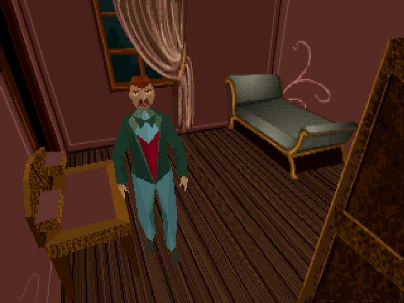
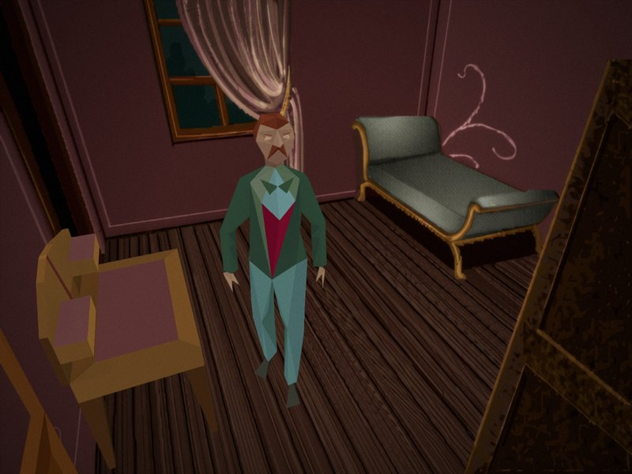
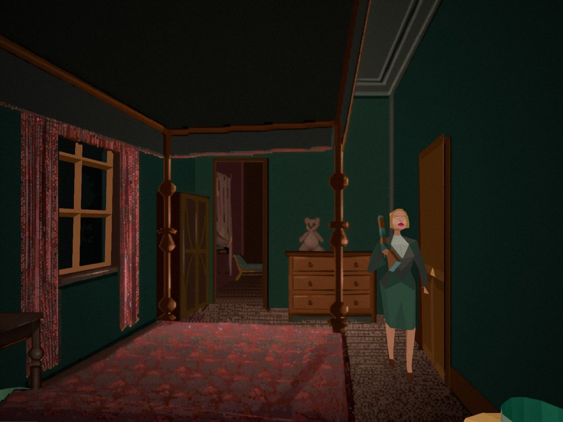
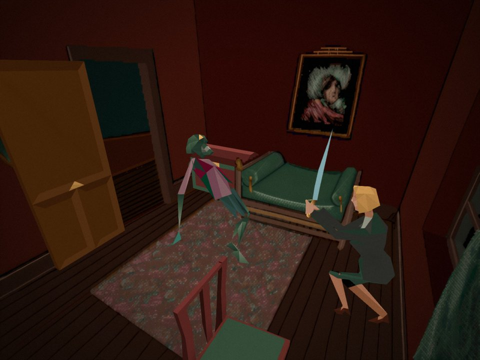
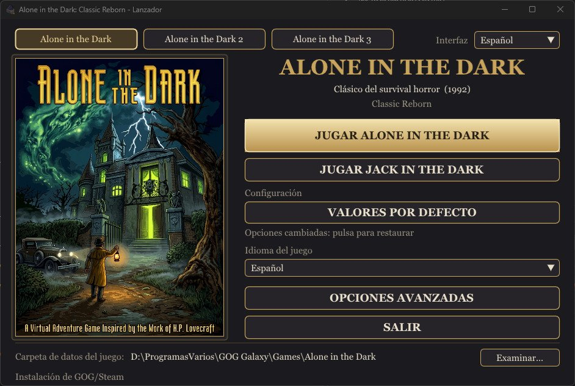
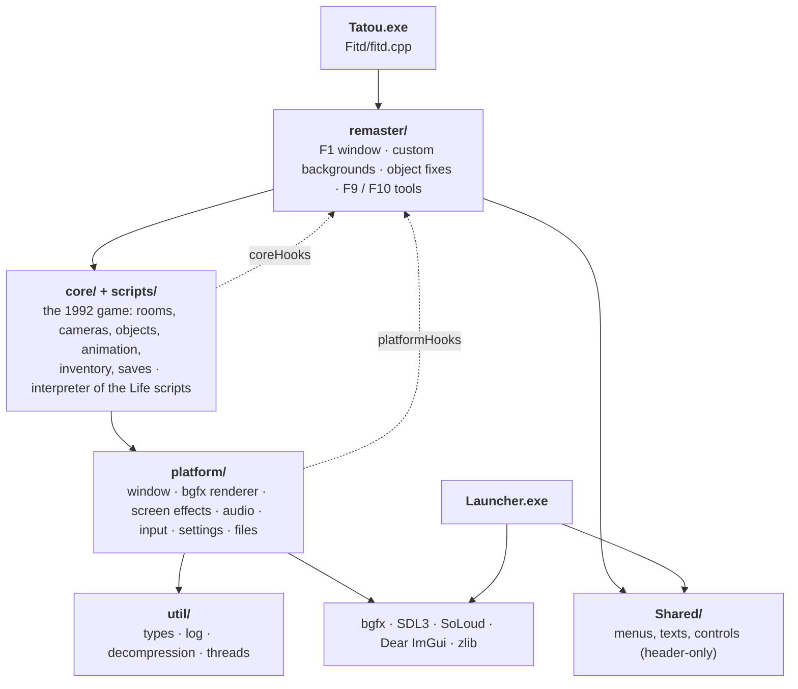

# Alone in the Dark: Classic Reborn

Play the original **Alone in the Dark** (1992) and **Jack in the Dark** on modern PCs, with their original graphics and a set of careful fixes and options.

Classic Reborn is a C++17 reimplementation of the Infogrames engine. It is a fork of [Alone in the Dark: Re-Haunted](https://github.com/spacefarergames/AloneInTheDarkReHaunted), itself based on [FITD (Free in the Dark)](https://github.com/yaz0r/FITD) by yaz0r. Its goal is the 1992 game as it was meant to be seen, without its defects: the remaster's HD mode was removed and every addition is optional.

> **The game data is not included.** You need your own copy of *Alone in the Dark* (the GOG or Steam edition). Nothing of the original game is in this repository.

## Screenshots

<table>
  <tr>
    <td align="center"><br><sub>The GOG edition</sub></td>
    <td align="center"><br><sub>Classic Reborn with the HD pack</sub></td>
  </tr>
  <tr>
    <td align="center"></td>
    <td align="center"></td>
  </tr>
</table>

<p align="center"><br><sub>The launcher</sub></p>

## How it was made

Classic Reborn is a **source port**: a hand-written reimplementation of the original engine in C++, not an automatic decompilation and not a static recompilation.

- **The engine** comes from FITD, which reverse engineered the DOS executable by hand into readable C++ (renderer, animation, collisions, cameras, inventory, saves...). It is *non-matching*: it behaves like the original, but it does not rebuild the original executable byte for byte. The engine's French function names (`AffObjet`, `LoadEtage`...) come from that work.
- **The game's logic** (doors, monsters, items, events) is not in the executable: it lives in the "Life" scripts of the game's own `LISTLIFE.PAK`, which the engine interprets as the original did. For study, the engine can translate those scripts into readable C++ (`TatouSource/FitdLib/scripts/native/`); the game always runs the original scripts.
- **Everything else** (graphics through bgfx, audio, controls, menus, fixes) is new code. Jack in the Dark's music is written for the AdLib sound chip, which modern PCs no longer have, so it plays through an emulation of that chip.

## Requirements

**To play**

- Windows 10 or 11, 64-bit, and a graphics card with DirectX 11.
- Your own copy of *Alone in the Dark*: the GOG or Steam edition (*Jack in the Dark* comes with it).
- Nothing else to install: no .NET, no Visual C++ Redistributable, no DirectX setup. Unzip and run `Launcher.exe`.

**To build the project**

- [Visual Studio 2022](https://visualstudio.microsoft.com/vs/) (the free Community edition works) with the **Desktop development with C++** workload. It includes CMake.
- [Git](https://git-scm.com/downloads) to download the repository.
- Optional: [Python 3](https://www.python.org/downloads/) for the scripts in `tools/` (dictionary of methods, layer check).
- Every library is included in the repository.

## Supported games

| Game | State |
| --- | --- |
| Alone in the Dark (1992, CD version) | Playable from start to end |
| Jack in the Dark (1993) | Playable |
| Alone in the Dark 2 and 3 | Not yet (the engine code inherited from FITD is there; the launcher shows them greyed out) |

## What it adds

- **Fixes** to the original: objects drawn in the wrong order, monsters stuck at windows, gaps in 3D models, lines at the edges of masks, game speed tied to the frame rate, and many more (see `docs/baseline/BUGS.md`).
- **Launcher** to choose the game, its language (the five of the GOG and Steam editions: English, French, German, Italian, Spanish) and the data folder, with the same options as the in-game **F1** window. The menus are translated into the same five languages.
- **Screen options**: resolution, aspect ratio (4:3, 16:10, stretched), fullscreen, frame limit, VSync.
- **Optional effects**: edge smoothing (FXAA) on the 3D models, bloom from the painted backgrounds, film grain, ambient occlusion (SSAO), smoother animations, sharper text.
- **Custom backgrounds**: export every background and mask of the game, enlarge or repaint them, and the game uses yours. A ready-made **HD pack** for both games is available (see [Custom backgrounds](#custom-backgrounds)).
- **Controls**: keyboard and game controller (Xbox, PlayStation, Nintendo Switch Pro and most other USB or Bluetooth controllers), every action can be changed, several inputs per action.
- **Separate volumes** for music and for voices and effects.
- **Saves** in the format of the GOG edition: saves made in the GOG game load here.
- **Menus** that adapt to any window size and work with mouse, keyboard, controller and touch.

## Getting started

1. Build the project (see [Building](#building)) or get a release.
2. Run **`Launcher.exe`** (next to `Tatou.exe`).
3. Press **Browse** and choose your game folder:
   - a **GOG or Steam installation** of *Alone in the Dark* (the folder with `GAME.GOG`, or its `INDARK` subfolder). Music and voices are read straight from the CD image; nothing is extracted or written there;
   - or a **copy of the game files** (a folder with the `.PAK` files; Jack in the Dark in its `JACK` subfolder).
4. Choose the language of the game and press **Play**. The GOG and Steam editions include five languages (English, French, German, Italian and Spanish), all available from the launcher. *Jack in the Dark* has its own button when its files are found.

## Controls

Every action can be changed in **Controls** (F1 window or launcher). Defaults:

| Action | Keyboard | Controller |
| --- | --- | --- |
| Move | Arrows or W A S D | D-pad or left stick |
| Run | Left Shift | L3 or right trigger |
| Action (use, fight, take) | Space | A |
| Confirm / inventory | Enter | Start |
| Cancel / pause menu | Esc | B |
| Options window (F1) | F1 or Home | Back |
| Fullscreen | F11 or Alt+Enter | — |

**Controllers.** Any controller Windows and SDL3 recognise works, connected by USB or Bluetooth, also when connected while playing: Xbox (One, Series, 360), PlayStation (DualShock 4, DualSense), Nintendo Switch Pro and most generic controllers. The table uses the Xbox names; on other controllers the buttons are in the same place:

| Xbox | PlayStation | Switch Pro |
| --- | --- | --- |
| A | Cross (✕) | B |
| B | Circle (○) | A |
| Start | Options | + |
| Back | Share / Create | − |
| L3 (press the left stick) | L3 | Left stick press |
| Right trigger | R2 | ZR |

The menus (launcher and F1) also work with the controller: left stick or D-pad to move, right stick to scroll, A to choose, B to go back. The mouse cursor hides while the controller is in use and comes back when the mouse moves.

## Options

The launcher's **Advanced options** and the in-game **F1** window share the same settings, saved in `aitd_remaster.cfg`:

| Option | What it does |
| --- | --- |
| Frames per second, VSync | Smoothness; the game speed never depends on them |
| Aspect ratio, resolution, fullscreen | How the 4:3 scene is shown |
| Edge smoothing | FXAA on the 3D models |
| Bloom | A soft glow from the bright parts of the painted backgrounds |
| Film grain | A light grain over the picture |
| SSAO | Soft shadows where surfaces meet |
| Smooth animations | Poses blended between the original key frames |
| Enhanced text | The game's letters redrawn sharp at screen resolution |
| Custom backgrounds | Uses your pictures instead of the originals |
| Audio | Music volume, voices and effects volume |
| Controls | The inputs of every action |

## Folders

Nothing is ever written to the game folder. Everything the game writes goes to **`UserData`**, next to the executables:

```
UserData/
├── aitd_remaster.cfg      options (shared by both games)
├── AITD1/                 Alone in the Dark
│   ├── Saves/             saves (SAVE0.ITD ... and their pictures SAVE0.png ...)
│   ├── tatou.log          log of the last session (tatou.prev.log: the one before)
│   ├── Backgrounds/       your backgrounds and full-screen pictures
│   ├── Masks/             your masks
│   └── Exports/           what F1 exports (masks in masks/, with guides in masks_guides/)
└── JACK/                  Jack in the Dark (same layout)
```

`launcher.cfg` and `launcher.log`, next to `Launcher.exe`, keep the launcher's own settings.

## Custom backgrounds

**HD pack.** HD backgrounds for *Alone in the Dark* and *Jack in the Dark*, ready to use: **[download from Google Drive](https://drive.google.com/file/d/1ps4ZVv-tBio4YYLrr8lVeiR8kiYFy5Z1/view?usp=sharing)** (a `.rar` file: Windows 11 opens it, or use [7-Zip](https://www.7-zip.org/)). Copy each game's pictures into `UserData\AITD1\Backgrounds` and `UserData\JACK\Backgrounds`, then switch on **Custom backgrounds** in F1 or in the launcher. The pack has backgrounds only: the game's own masks keep working with them.

To make your own:

1. In F1, **export** the backgrounds and the masks. They go to `Exports/` as PNG files at the original 320×200, named after their place in the game files (`CAMERA00_000.png`, `CAMERA00_000_mask_1_0.png`...).
2. Enlarge or repaint them with any tool. Any size works:
   - **16:10** like the original (320×200, 1280×800...) or **4:3**: the whole picture is the play area;
   - **wider than 4:3** (16:9...): its 4:3 centre is the play area and the sides fill the black bars in fullscreen.
3. Save them with the same name in `Backgrounds/` (masks in `Masks/`; white covers the characters). Switch on **Custom backgrounds**: pictures saved while playing appear at once.

Masks matter when your picture moves or redraws an object that stands in front of the characters.

## Saves

Saves of *Alone in the Dark* use the layout of the GOG edition: saves made in the GOG game (`cloud_saves\INDARK` in its folder) can be copied to `UserData\AITD1\Saves` and loaded. The other way round works too, except that the lamp's oil does not run out in the GOG game with a save made here (known issue). The save list shows the date and time of each save.

## Building

See [Requirements](#requirements). From the folder of the repository:

```
cmake -G "Visual Studio 17 2022" -A x64 -S TatouSource -B TatouSource\build\vs2022
```

Open `TatouSource\build\vs2022\FITD.sln`, choose **RelWithDebInfo x64** and build. `Launcher.exe` and `Tatou.exe` end up together in `TatouSource\build\vs2022\Fitd\RelWithDebInfo`; `Launcher` is the start project.

**Development tools.** The CMake option `CLASSIC_REBORN_DEV_TOOLS` (on by default) builds two tools that only work in debug mode: **F9** gives any item, **F10** is the object editor used to make the visual fixes of 3D objects. For a build to share with players, turn it off:

```
cmake -S TatouSource -B TatouSource\build\vs2022 -DCLASSIC_REBORN_DEV_TOOLS=OFF
```

**Debug mode** is switched on by hand: `debugMode = 1` in `launcher.cfg`. With a copy of the game files it also keeps every file the game writes inside that copy.

**Releases.** The zip of each release is built by GitHub Actions (`.github/workflows/release.yml`) with the same script: publishing a release with a tag like `v1.0.0-beta.1` attaches `ClassicReborn-1.0.0-beta.1-windows.zip` to it. Locally: `powershell -ExecutionPolicy Bypass -File tools\makeRelease.ps1 -Version 1.0.0-beta.1`.

Linux and Android are planned; most of the libraries already support them.

## Architecture

```
┌──────────────────────────────────────────────────────────────────────────┐
│  Tatou.exe  (Fitd/fitd.cpp)        starts the engine, connects remaster  │
└────────────────────────────────────┬─────────────────────────────────────┘
                                     │
┌────────────────────────────────────▼─────────────────────────────────────┐
│  remaster/                   optional additions                          │
│  ┌──────────────┐ ┌────────────────────┐ ┌────────────┐ ┌──────────────┐ │
│  │  F1 window   │ │ custom backgrounds │ │ 3D object  │ │ F9 / F10     │ │
│  │ menu fonts   │ │ export / import    │ │ fixes      │ │ dev tools    │ │
│  └──────────────┘ └────────────────────┘ └────────────┘ └──────────────┘ │
└────────────────────────────────────┬─────────────────────────────────────┘
                     ▲ hooks         │ uses
┌────────────────────┴───────────────▼─────────────────────────────────────┐
│  core/ + scripts/            the 1992 game                               │
│  ┌──────────────┐ ┌──────────────┐ ┌──────────────┐ ┌──────────────────┐ │
│  │ rooms        │ │ objects      │ │ inventory    │ │ Life scripts     │ │
│  │ cameras      │ │ animation    │ │ books        │ │ (interpreter)    │ │
│  │ masks        │ │ collisions   │ │ saves        │ │ native C++ copy  │ │
│  └──────────────┘ └──────────────┘ └──────────────┘ └──────────────────┘ │
└────────────────────────────────────┬─────────────────────────────────────┘
                     ▲ hooks         │ uses
┌────────────────────┴───────────────▼─────────────────────────────────────┐
│  platform/                   the system                                  │
│  ┌──────────────┐ ┌──────────────┐ ┌──────────────┐ ┌──────────────────┐ │
│  │ window       │ │ renderer     │ │ audio        │ │ input, controls  │ │
│  │ ImGui        │ │ screen       │ │ CD tracks    │ │ settings         │ │
│  │              │ │ effects      │ │ AdLib, VOC   │ │ game folders     │ │
│  └──────────────┘ └──────────────┘ └──────────────┘ └──────────────────┘ │
└────────────────────────────────────┬─────────────────────────────────────┘
                                     │
┌────────────────────────────────────▼─────────────────────────────────────┐
│  util/        types · log file · PAK decompression · threads             │
└──────────────────────────────────────────────────────────────────────────┘

┌───────────────┐    ┌──────────────────────────────────┐
│ Launcher.exe  ├───►│ Shared/  menus, texts, controls  │◄── also used by the game
└───────────────┘    └──────────────────────────────────┘

Libraries: bgfx (graphics) · SDL3 (window, input) · SoLoud (audio) · Dear ImGui (menus) · zlib
```

The same structure as a graph: who uses whom (solid arrows) and where the hooks go up (dotted arrows).



Each layer only uses the layers below it. When a lower layer has something to announce (a camera background is ready, the menus can be drawn, a key was pressed...), it calls a **hook**: an empty function pointer that the remaster fills in when it starts. With no remaster connected, the engine behaves as the original game.

More detail:

- `docs/MAPA_CODIGO.md`: every folder and file, the shaders and a glossary of the engine's French names.
- `docs/DICCIONARIO.md`: every public function and what it does, generated from the headers by `tools/makeDictionary.py`.
- `docs/baseline/BUGS.md`: the defects found and how each one was fixed.
- `docs/DESCARTADO.md`: what was removed from the remaster and why.
- `CHANGELOG.md`: the changes of this fork before it was published.
- `tools/checkLayers.py`: lists any `#include` that goes against the layer order.

These documents are in Spanish for now.

## Credits

This project exists thanks to the people who came before it. Re-Haunted brought the engine to modern systems and added many of the ideas this fork builds on; FITD made the engine readable in the first place. Some of their features were removed here only because this fork has a narrower goal (the 1992 game with its original graphics), not because of their quality; `docs/DESCARTADO.md` explains each removal.


- **FITD (Free in the Dark)**: the reverse-engineered engine, by yaz0r and contributors: <https://github.com/yaz0r/FITD>
- **Alone in the Dark: Re-Haunted**: the remaster this fork comes from, by Spacefarer Retro Remasters (Jake Jackson): <https://github.com/spacefarergames/AloneInTheDarkReHaunted>
- **Alone in the Dark** and **Jack in the Dark** were created by Infogrames. This project contains none of their data and is not affiliated with their rights holders.
- Libraries: [bgfx](https://github.com/bkaradzic/bgfx), [SDL3](https://github.com/libsdl-org/SDL), [SoLoud](https://github.com/jarikomppa/soloud), [Dear ImGui](https://github.com/ocornut/imgui), [zlib](https://zlib.net), and the OPL2 (AdLib sound chip) emulator from MAME, which plays Jack in the Dark's music: it was written for that chip, which modern PCs no longer have.

## License

GNU General Public License v2: see [LICENSE](LICENSE). The libraries in `TatouSource/ThirdParty` keep their own licenses.
